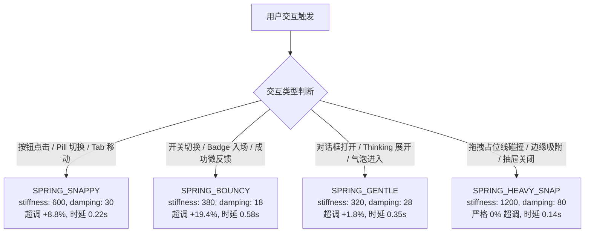

<p align="center">
  [⬅️ 上一篇：第七篇：工程配置与资产代码库总览](07-工程配置与资产代码库总览.md) · [📚 返回总目录](Claude%20Design%20System%20(CDS).md)
</p>

---

# 第八篇：AI Agent 前端 UI 与动效开发指南 (AI Agent Frontend UI & Motion Guidelines)

> **适用对象**：Cursor Agent, Claude Code, GitHub Copilot, Windsurf, Devin, Antigravity 及所有接入代码库的自主式或辅助式 AI 智能体。  
> **核心使命**：指引 AI Agent 在阅读、生成、重构基于 Claude Design System (CDS) 的前端组件与页面时，严格遵循真实 REA v6.5.0 提取的生产级规范：人文温润质感、二阶弹簧动力学、单闭合边框原则与零版权风险规范。**杜绝任何未经取证的凭空臆测**。

---

## 🧭 导航目录
- [8.1 Agent 角色定位与设计哲学](#81-agent-角色定位与设计哲学)
- [8.2 设计令牌与色彩引用契约](#82-设计令牌与色彩引用契约)
- [8.3 动效物理学：四套弹簧预设决策树](#83-动效物理学四套弹簧预设决策树)
- [8.4 控件原子规则与单闭合边框原则](#84-控件原子规则与单闭合边框原��)
- [8.5 交互防御与边缘场景守卫](#85-交互防御与边缘场景守卫)
- [8.6 生产级组件库快速装配指南 (30 模块)](#86-生产级组件库快速装配指南-30-模块)
- [8.7 智能体自检与质量门禁清单](#87-智能体自检与质量门禁清单)

---

## 8.1 Agent 角色定位与设计哲学

当 Agent 在本项目或下游消费项目中使用 CDS 时，必须理解 Anthropic Claude 界面的根本差异点：

1. **温润的人文质感（Editorial Warmth）**：
   - 严禁生成高饱和度的赛博朋克蓝/紫渐变或刺眼的荧光色。
   - 品牌主强调色为**陶土色（Clay: `#d97757` / Hover: `#cc5a36` / Light: `#fbf3ef`）**。
   - 界面底色使用微温的纸质灰底（`--cds-surface-0: #f9f9f7` / 暗色 `--cds-surface-0: #0b0b0b`），严禁在深色模式滥用生硬的 `#000000`（代码高亮背景 `#0d0d0c` 除外）。
2. **多层微对比表面（Low-contrast Surface Layering）**：
   - 放弃传统的 1px 黑色硬描边思维，通过 `Surface 0 ~ 3` 的层级微小明度差（阶梯差仅 1%~3%）与 `border-subtle` 发丝细线（浅色 10% / 暗色 9%）构建深邃沉浸的空间。
3. **触感物理反馈（Tactile Organic Physics）**：
   - 严禁使用 CSS 默认的 `ease`、`linear` 或过度弹跳的夸张动画。
   - 所有的位移、缩放、展开必须依托基于质量��刚度与阻尼的真实弹簧动力学模型（`ClaudeMotionPresets.ts`）或 15 阶 CSS `linear()` 弹簧曲线。

---

## 8.2 设计令牌与色彩引用契约

所有样式必须优先引用预置 CSS 变量或 Tailwind 扩展类名（见 [`code-examples/cds-theme.css`](../code-examples/cds-theme.css) 与 [`code-examples/tailwind.config.js`](../code-examples/tailwind.config.js)）：

### 1. 表面体系对应表 (REA v6.5.0 取证规范)
```css
/* Agent 编写组件时应使用的背景颜色映射 */
:root {
  --cds-surface-0: var(--cds-gray-20); /* #f9f9f7 侧边栏/画布底层 Canvas */
  --cds-surface-1: var(--cds-gray-10); /* #fcfcfb 页面主聊天画布背景 */
  --cds-surface-2: var(--cds-gray-0);  /* #ffffff 消息卡片表面 */
  --cds-surface-3: var(--cds-gray-0);  /* #ffffff 输入框容器/高层浮层 */
  --cds-surface-popover: var(--cds-gray-0); /* #ffffff 悬浮 Popover 表面 */
}

[data-mode="dark"], .dark {
  --cds-surface-0: var(--cds-gray-900); /* #0b0b0b 暗色侧边栏/底色 */
  --cds-surface-1: var(--cds-gray-850); /* #151515 暗色主聊天背景 */
  --cds-surface-2: var(--cds-gray-830); /* #1a1a19 暗色卡片表面 */
  --cds-surface-3: var(--cds-gray-800); /* #20201f 暗色输入框与高层浮层 */
  --cds-surface-popover: var(--cds-gray-750); /* #2c2c2a 悬浮气泡表面 */
}
```

### 2. 文本与排版阶梯
```css
--cds-text-primary:   #151515; /* 一级主要正文、标题 / [Dark]: #f5f5f5 */
--cds-text-secondary: #525252; /* 二级辅助文字、副标题 / [Dark]: #a3a3a3 */
--cds-text-muted:     #8a8a8a; /* 三级微弱文字、快捷键、占位符 / [Dark]: #666666 */
```

### 3. 双环聚焦光晕与陶土弥散环
在为按钮、输入框、下拉菜单实现聚焦态时，统一采用双层环状阴影（内层微对比，外层陶土色漫反射）：
```css
--cds-focus-shadow: inset 0 0 0 1px var(--cds-surface-1), 0 0 0 1.5px var(--cds-clay), 0 0 6px 1px rgba(217, 119, 87, 0.25);
```

---

## 8.3 动效物理学：四套弹簧预设决策树

Agent 在编写交互动画时，必须从 [`code-examples/ClaudeMotionPresets.ts`](../code-examples/ClaudeMotionPresets.ts) 导入标准弹簧配置，根据场景决策：



### 7 档非线性透明度遮罩 (7-Stop Non-Linear Alpha Mask)
当 Agent 实现滚动视口（如对话流、侧边栏历史、代码块）边缘渐隐时，严禁使用单段线性渐变，必须使用官方经感知伽马校准的 7 档非线性采样点：
```css
mask-image: linear-gradient(
  to bottom,
  transparent,
  #0000000d calc(var(--cds-scroll-fade-top) * .15),
  #00000026 calc(var(--cds-scroll-fade-top) * .3),
  #0000004d calc(var(--cds-scroll-fade-top) * .45),
  #00000080 calc(var(--cds-scroll-fade-top) * .6),
  #000000b3 calc(var(--cds-scroll-fade-top) * .75),
  #000000d9 calc(var(--cds-scroll-fade-top) * .87),
  #000 var(--cds-scroll-fade-top),
  #000 calc(100% - var(--cds-scroll-fade-bottom)),
  #000000d9 calc(100% - var(--cds-scroll-fade-bottom) * .87),
  #000000b3 calc(100% - var(--cds-scroll-fade-bottom) * .75),
  #00000080 calc(100% - var(--cds-scroll-fade-bottom) * .6),
  #0000004d calc(100% - var(--cds-scroll-fade-bottom) * .45),
  #00000026 calc(100% - var(--cds-scroll-fade-bottom) * .3),
  #0000000d calc(100% - var(--cds-scroll-fade-bottom) * .15),
  transparent
);
```

---

## 8.4 控件原子规则与单闭合边框原则

### 1. 单闭合边框原�� (Single-Stroke Border Discipline)
* **核心禁忌**：严禁在一个带边框的容器（如 `ChatComposer` 或 `AttachmentCard`）内部，再放置带有独立边框的次级按钮或功能 Chips。
* **正确做法**：容器内部的内联按钮必须使用 `border-none` + `bg-transparent`，仅依靠 Hover 时的 `Surface` 背景色变化与图标对比度提升来传达可交互性。

### 2. 五级按钮尺寸阶梯 (REA v6.5.0 取证规范)
| 规格 | 高度 | 水平内边距 | 字号 | 边框与圆角 | 触感物理曲线 |
| :--- | :--- | :--- | :--- | :--- | :--- |
| **XS** | 20px (`h-5`) | 6px (`px-1.5`) | 11px (`text-[11px]`) | 4px (`rounded`) | 15 阶 `linear()` 弹簧曲线 |
| **SM** | 24px (`h-6`) | 8px (`px-2`) | 12px (`text-xs`) | 6px (`rounded-md`) | 15 阶 `linear()` 弹簧曲线 |
| **MD** | 28px (`h-7`) | 10px (`px-2.5`) | 13px (`text-[13px]`) | 8px (`rounded-lg`) | 15 阶 `linear()` 弹簧曲线 |
| **LG** | 32px (`h-8`) | 12px (`px-3`) | 14px (`text-sm`) | 8px (`rounded-lg`) | 15 阶 `linear()` 弹簧曲线 |
| **XL** | 40px (`h-10`) | 16px (`px-4`) | 16px (`text-base`) | 10px (`rounded-xl`) | 15 阶 `linear()` 弹簧曲线 |

### 3. 等宽数字约束 (Tabular Numbers)
所有涉及计数器、Token 仪表、音频波形柱、时间戳或 Diff 行号的场景，必须显式声明 `tabular-nums`，彻底避免数字跳变引发���水平抖动。

---

## 8.5 交互防御与边缘场景守卫

在编写业务交互逻辑时，Agent 必须默认植入以下 4 个防御守卫：

### 1. WebKit 500ms Post-Composition 守卫
输入框输入法合成结束时，WebKit 引擎会残留微秒级合成标志位，必须双重拦截：
```typescript
const handleKeyDown = (e: React.KeyboardEvent<HTMLTextAreaElement>) => {
  // 1. 标准合成标志位与 229 键码
  if (e.nativeEvent.isComposing || e.keyCode === 229) return;
  // 2. WebKit 500ms 虚假回车守卫拦截（仅针对回车键，并重置时间戳防误吞后续正常输入）
  if (isWebKit && (e.key === 'Enter' || e.keyCode === 13) && Math.abs(e.timeStamp - lastCompositionEndTime) < 500) {
    lastCompositionEndTime = -1;
    e.preventDefault();
    return;
  }

  if (e.key === 'Enter' && !e.shiftKey) {
    e.preventDefault();
    submitMessage();
  }
};
```

### 2. 流式滚动防抢夺图钉 (150ms Cooldown Latch)
在流式对话吐字期间，若用户向上微滚查看历史记录，严禁强行拉回底部。设置 40px 底部容差与 150ms 冷却时间戳互锁：
```typescript
const handleUserScroll = () => {
  lastUserScrollTimestamp.current = performance.now();
};

const shouldAutoScroll = () => {
  const isWithinBottomTolerance = scrollHeight - scrollTop - clientHeight <= 40;
  const isCooldownExpired = performance.now() - lastUserScrollTimestamp.current > 150;
  return isWithinBottomTolerance && isCooldownExpired;
};
```

### 3. 沙箱安全与用户激活门禁 (Iframe Security)
在处理 Artifacts 工件预览或外部代码注入时：
* 严格移除 `allow-same-origin`，确保 `null-origin` 物理隔离；
* 跨域 `postMessage` 校验来源；
* 触发系统级调用前校验原生 `event.userActivation`。

### 4. 零外部黑盒音频资产 (Procedural Audio Synthesis)
严禁在代码中 `fetch` 或 `import` 外部未授权的 `.mp3` 音频文件。统一使用原生 Web Audio API 振荡器和弦合成，并加入平滑增益淡入淡出（防爆音），将音量锁定在舒缓的 30% 基准。

---

## 8.6 生产级组件库快速装配指南 (30 模块)

当 Agent 需要实现对应页面功能时，直接在 [`code-examples/`](../code-examples/) 中查找并复用：

```
code-examples/
├── CdsButton.tsx                    # 5 级尺寸 5 大变体标准按钮 (15 阶 linear 弹簧)
├── SegmentedControl.tsx             # 999px 全圆角滑动分段胶囊 (2px 轨道几何)
├── StatusIndicators.tsx             # 6px 状态指示灯与骨架屏扫光
├── ConfirmationDialog.tsx           # 16px 模态确认对话框 (双环弥散投影)
├── AttachmentCard.tsx               # 7.5rem 磁贴与行内附件芯片
├── ChatComposer.tsx                 # 20px 核心输入终端
├── ChatMessageBubbles.tsx           # 会话流双态气泡 (18px 圆角与 clamp 文本 stop)
├── ThinkingAccordion.tsx            # 思考过程状态机折叠组件 (Grid 0fr<->1fr)
├── RichComposerWithMentions.tsx     # 指令与提及富文本编辑器 (WebKit 500ms 守卫)
├── ModelSwitcherWithTokenGauge.tsx  # 模型切换与四色 Token 显存表
├── McpToolDecisionCard.tsx          # MCP 决策与授权卡片
├── ClaudeMotionPresets.ts           # 4 套物理弹簧预设
├── ReasoningAmbientGlow.tsx         # 陶土漫反射光效 (wl-glow & 1.1s epitaxy-sweep)
├── ScrollFadeContainer.tsx          # 原生 CSS Scroll-Driven 7 档非线性遮罩容器
├── ClaudeAudioPlayer.ts             # Web Audio 纯代码合成音效
├── LiveMicActivityBars.tsx          # 6 频段非线性麦克风波形柱 (0.7 Gamma)
├── MediaLightboxViewer.tsx          # 仿射变换光标锚点画廊 (75vw 跑道)
├── useClaudeSharedElementTransition.ts # View Transitions 共享元素变形 Hook
├── ArtifactsSplitPaneResizer.tsx    # 50/50 居中吸附双栏分割条 (4px 死区)
├── EpitaxyIframeBridge.tsx          # 沙箱隔离双向通信桥 (null-origin 隔离)
├── StreamingDiffViewer.tsx          # 等宽流式代码差异对��� (--diffs-* 变量)
├── CodeBlock.tsx                    # 12px 纯黑底色高亮代码块
├── createClaudeMainWindow.ts        # Electron 桌面窗口工厂 (WebContentsView 解耦)
├── ClaudeDesktopHeader.tsx          # macOS 74px 避让沉浸式顶栏
├── DraggableSessionList.tsx         # 拓扑重排与微倾斜投影
├── CoworkAgentCanvas.tsx            # 多 Agent 协同网格看板
├── useClaudeScrollPinning.ts        # 视口图钉防抢夺 Hook (150ms 冷却)
├── ContainerResponsiveBar.tsx       # 4 阶容器查询响应栏
├── useClaudeRovingFocus.ts          # W3C WAI-ARIA 焦点漫游 Hook
└── useRateLimitBackoff.ts           # 指数退避与全抖动重试 (3 次上限保护)
```

---

## 8.7 智能体自检与质量门禁清单

Agent 在完成任何前端代码修改或产物提交前，**必须逐项自检并执行验证**：

- [ ] **语义令牌**：是否全部使用了 `var(--cds-*)` 或 Tailwind 扩展语义类？（严禁随意写死假色）
- [ ] **物理弹簧**：动态交互是否均来自 `ClaudeMotionPresets` 或 15 阶 `linear()` 弹簧？（严禁手写无物理阻尼的简单动画）
- [ ] **输入防御**：文本输入事件是否已包含 WebKit 500ms post-composition 守卫？
- [ ] **暗黑适配**：在 `:root` 与 `.dark` 下背景明度对比与文本对比���否正常？
- [ ] **排版抖动**：频繁变化的数字与指标是否附加了 `tabular-nums`？
- [ ] **单闭合边框**：容器内二级控件是否做到了 `border-none`？
- [ ] **代码构建**：
  ```bash
  npm run typecheck # 必须 0 TS 类型报错
  npm run build     # 必须成功输出 0 编译错误
  ```

---

<p align="center">
  [⬅️ 上一篇：第七篇：工程配置与资产代码库总览](07-工程配置与资产代码库总览.md) · [📚 返回总目录](Claude%20Design%20System%20(CDS).md)
</p>
