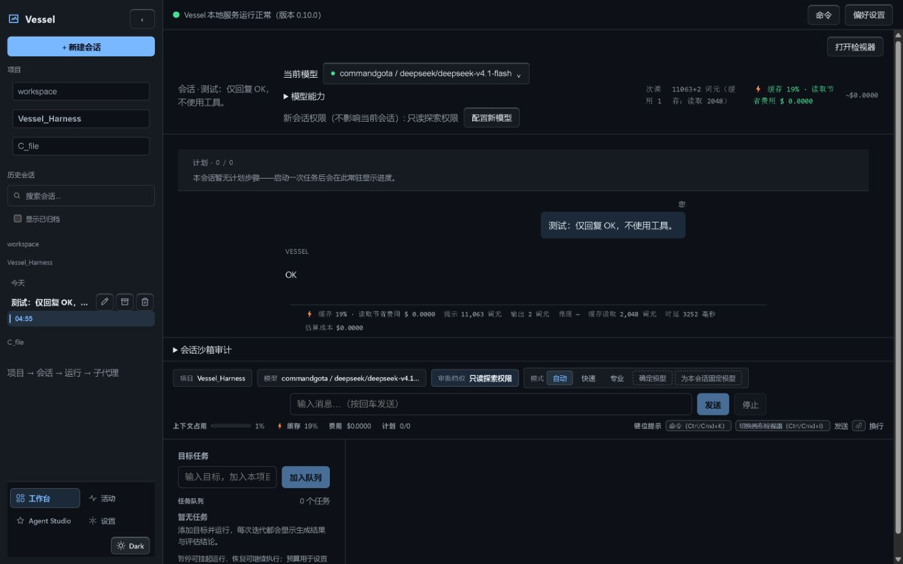
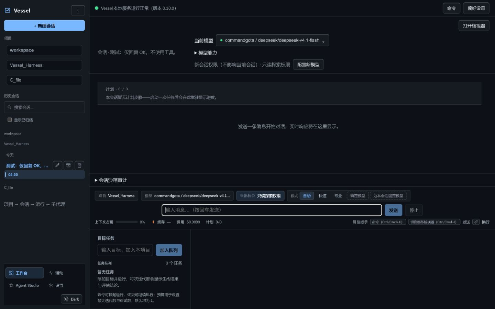

# Vessel browser verification — 2026-10-21

## Conclusion

**Audit delivered; product acceptance is not fully passed.** Six scenarios exercised: **4 PASS, 2 FAIL**. Scenario 2 fails the complete acceptance gate because native OS IME candidate confirmation could not be exercised; its modeled browser composition check passed. Scenario 4 has reproduced product failures. Additional reload testing reproduced loss of visible conversation history despite intact persisted records.

No product source, dependencies, PDW configuration, commits, pushes, or publication changed. Existing user sessions were not deleted. The two disposable sessions and one provider connection test are described below.

## Environment and method

- Checkout: `4600d009560012f29f1dadfc5f1bab392cfd79cd`, initially clean. This report describes the actual served build, not the older review documents' baseline SHA.
- Windows, Node `v24.14.0`; Codex built-in browser (IAB), reported UA `Chrome/155.0.0.0`, DPR approximately 1.
- Service: requested `npx tsx apps/cli/src/cli.ts serve --port 5678`; port checked free before launch. Background launcher PID 11340. HTTP `/` returned **200**. Service retained on `http://127.0.0.1:5678`.
- Served existing `apps/web/dist`; index timestamp 2026-10-20 17:57:45 local. No rebuild was performed. Version `0.10.0` is the frozen package version, not a claim about delivery age.
- Audit window approximately **04:41–05:06 PDT, 2026-10-21**, including setup, browser work and evidence assembly. Browser observations mainly 04:44–05:01 PDT.
- Captured viewports: **1440×900**, **800×1000**, **390×844**, dark and light. Dimensions are in [screenshots.json](2026-10-21-browser-verification/screenshots.json).
- UI actions used the built-in browser; CDP observed local network requests and exercised mouse input. The IME fallback injected transient DOM composition events; it did not install an OS input method or alter product code.
- Required documents read: execution mission, browser testing spec, `VESSEL-ARCH-2026-02`, `VESSEL-UI-2026-03`, project handoff and current task/evidence records. Visual acceptance skill applied to the live served surface; no replacement HTML harness or fabricated before-state screenshots.

## Six scenario verdicts

| # | Verdict | Observed result and boundary | Evidence |
|---|---|---|---|
| 1 — Layout, controls, themes | **PASS** | Sidebar/main reach the viewport edges; body margin 0; approximately 1 CSS px separators. Dark/light surfaces remain distinct and readable. Actual command-button hover matched `:hover`; held mouse matched `:active` and translated downward during its 1px transition. Tablet/mobile navigation becomes a drawer, Escape closes it and restores opener focus. This is a visual/interaction pass, not a complete WCAG AA certification. | 01–07, 31–36; browser-observations.json |
| 2 — IME and input | **FAIL — native coverage blocked** | `ceshi` + modeled `compositionstart` + real browser Enter retained the draft and created no session. After `compositionend`, ordinary Enter created one task, submitted the test message once and received `OK`. Shift+Enter retained multiline input. Native `Input.imeSetComposition` is unsupported in IAB; no OS candidate window or real Chinese/Japanese IME confirmation was tested. A modeled pass cannot close that native requirement. | 08, 27–28; turn-proof.json; ime-tests.log |
| 3 — Creation and Recycle Bin deletion | **PASS** | The stale default workspace failed visibly. Valid repository path created read-only disposable session `sess_1792583237359_cffa6b33`. Cancel retained it. Confirm removed it only after server completion. Original directory and registry entry are absent; matching Windows `$I` original-path metadata and `$R` payload exist. Reload did not resurrect it. Delete-error/partial-batch fault injection was outside this six-scenario run. | 09–14; delete-proof.json |
| 4 — Activity truth and navigation | **FAIL** | Failed goal correctly displays failed. Live completed test has a persisted successful terminal event and a working Activity → Session button. However, two canonical **pending** goals display **running**, and clicking the failed goal card does nothing. No goal detail action exists. Priority order failed before running is visible; an approval fixture was not created. | 15–16, 29; activity.json; activity-after-turn.json; goal-source-status.json; turn-proof.json |
| 5 — Provider stored-key connection | **PASS — layered evidence** | Clicked configured provider's direct test without entering a key. Captured POST body contains `apiKey: ""`; local response HTTP 200 and UI reports success in **2071 ms**. Saved destination shown is `https://api.commandcode.ai/provider/v1`. Browser network observation sees the local API, not the server's upstream socket. Fresh offline regression probe separately verified saved endpoint/protocol binding under spoofed URL/protocol and empty/omitted key. No real key was copied or exposed. | 17–18; provider-network.json; verify-250.log |
| 6 — Studio and Inspector | **PASS** | Added one rule and compiled candidate: UI explicitly says inactive draft and not applied to the running Agent; removed draft afterward. Inspector already groups eight tools into **Changes / Execution / Diagnostics**. Clicked all three groups, Cache and Context; command palette's Cache action reaches Diagnostics/Cache. Mobile Inspector is a dialog; Escape closes it and restores opener focus. No runtime activation was performed. | 19–26, 30, 35 |

The browser guide's claims that Rail consolidation and eight-flat-tab grouping remain unfinished are stale for this served build. They must not be recycled as current findings.

## Reproduced findings

### BV-01 — P1: reload loses visible history while disk remains intact

1. On Workbench select `Vessel_Harness`, read-only permission, submit `测试：仅回复 OK，不使用工具。`.
2. Observe exactly one visible user message and assistant `OK` (28, 36).
3. Reload, wait for service/model loading, then reopen that session in the sidebar.
4. Observe empty-conversation hint, zero context usage and no prior messages (37; reloaded-session-dom.txt).

Retained reproducer: **`sess_1792583751073_cc114a5b`**. Disk still contains one submitted test message, an injected instruction message, one assistant message and `turn/end.kind=success`, `executionState=COMPLETED`; see [turn-proof.json](2026-10-21-browser-verification/turn-proof.json). This is presentation/replay loss, not evidence of physical data deletion. The session was deliberately retained for repair reproduction.

An older archived session, `sess_1792074112811_80d0dddc`, also has an existing 27,429-byte log but opens empty with model-loading error and Trace `session_not_found` (21–23). Its GET path requires an in-memory controller in `apps/local-server/src/server.ts`; opening historical records lacks a usable recovery path in this observation. Do not assume this has the same root cause as the live-session reload bug. HANDOFF's older Task 219 history-fix claim does not override this fresh reproduction.

### BV-02 — P1: queued goals are misrepresented as running

`goal-source-status.json` records two `pending` tasks, while the same IDs in `activity.json` are `running`. `apps/local-server/src/routes/activityRoutes.ts` maps the remaining goal states to running, including pending. A failed task's `not_met` → failed mapping is correct. Preserve queued/pending explicitly rather than claiming active execution.

### BV-03 — P2: goal Activity cards have no destination

Clicking `Verify the build and stage the diff` left the view unchanged. `apps/web/src/components/activity/ActivityQueue.tsx` only renders a navigation button for `kind === 'session'`; observed goal records have neither detail links nor a disabled/unavailable explanation. The newly completed session's link worked, so this is kind-specific.

### BV-04 — P2: stale default project and misleading refresh label

The selected default project points at a removed temp workspace. Create fails visibly, but the error groups workspace and model issues together. Activity and task-tree refresh buttons say “重新加载模型” even though those actions refresh activity/tasks. Prefer a valid recent project and action-specific copy.

## Alignment scores against the two review documents

These are **evidence-backed lower-bound acceptance scores**, not an estimate of how much source code is implemented. Equal weight per work package; 1 = observed acceptance, 0.5 = partial supporting evidence, 0 = failed or outside this audit's evidence. Untested is not asserted missing. Full architecture certification cannot be inferred from six UI scenarios.

| Architecture package | Credit | Reason |
|---|---:|---|
| ARCH-01 state truth | 0.5 | Successful terminal aligns; pending goal projection fails |
| ARCH-02 deletion | 0.5 | Real Recycle Bin success; fault/partial-batch paths not exercised |
| ARCH-03 recovery | 0 | No crash/permit/journal fault injection this run |
| ARCH-04 external runtimes | 0 | No external agents launched or interactive capability proof |
| ARCH-05 provider/catalog | 0.5 | Stored destination binding supported; SSOT/full negotiation not certified |
| ARCH-06 replay consistency | 0 | Live reload history failure |
| ARCH-07 authorization | 0 | No adversarial authorization/subagent scope checks |
| ARCH-08 context conservation | 0.5 | Real layered-cache attribution inspected; no long-history compaction |
| ARCH-09 reproducible gates | 0.5 | Screenshots, targeted checks and receipts; no full build/test battery |
| **ARCH total** | **2.5 / 9 = 27.8%** | Evidence coverage lower bound |

| UI package | Credit | Reason |
|---|---:|---|
| UI-01 deletion | 0.5 | Success/cancel/reload passed; injected failures not covered |
| UI-02 Activity truth | 0.5 | Failed/completed correct; pending mislabeled running |
| UI-03 single navigation | 1 | Consolidated sidebar; responsive drawer |
| UI-04 action center | 0 | Goal navigation absent |
| UI-05 Inspector groups | 1 | Three groups and command Cache route observed |
| UI-06 Provider Hub | 0.5 | Connection succeeds; configured/add catalog still share a long surface |
| UI-07 Studio semantics | 1 | Candidate compilation explicitly inactive |
| UI-08 placeholder removal | 0 | Full Customize module audit not covered |
| UI-09 conversation/input | 0.5 | Real turn and modeled input pass; reload history fails |
| UI-10 visual/accessibility | 0.5 | Three widths and both themes; full language/zoom/AA matrix incomplete |
| **UI total** | **6 / 10 = 60%** | Evidence coverage lower bound |

Six-scenario strict gate pass rate: **4/6 = 66.7%**. No combined score should obscure the history and false-running findings.

## Screenshot evidence index

All **37 original browser JPEGs** are under [2026-10-21-browser-verification](2026-10-21-browser-verification/); [screenshots.json](2026-10-21-browser-verification/screenshots.json) lists every filename, dimensions, byte size, SHA-256 and corner pixel sample. No generated mockups or substituted screenshots.

| Evidence range | Contents |
|---|---|
| 01–02 | Desktop dark/light home |
| 03–04 | Tablet light/dark home |
| 05–07 | Mobile dark home, navigation drawer, light home |
| 08 | Shift+Enter input retained |
| 09–14 | Invalid path, create, confirm, cancel, delete result, reload |
| 15–16 | Activity projection and unchanged failed-goal click |
| 17–18 | Provider Hub and connection result |
| 19–20 | Studio candidate, including full-page compiled result |
| 21–24 | Inspector desktop groups, historical-session failure, both themes |
| 25–26 | Tablet/mobile Inspector dark |
| 27–28 | Modeled composition retained, real completed turn |
| 29–30 | Completed Activity and live context inspection |
| 31–33 | Real conversation tablet dark/light and mobile light |
| 34–36 | Button held active, command Cache route, desktop dark conversation |
| 37 | Reloaded live session with missing visible history |

## Verification and limits

- HTTP 200; real browser clicks and original screenshots; disk/registry/Recycle Bin correlation passed for the deleted disposable session.
- Fresh `node evidence/sessions/2026-10-20-codex-adversarial-review-249-probes.mjs --verify-250`: **exit 0**, offline F1/F2/F3 controls PASS. This is stubbed security evidence, separate from the real browser provider test.
- Fresh `npx vitest run --root apps/web src/components/TaskComposer.test.tsx`: **8/8 pass** (the invocation also included a nonexistent optional filter which matched no additional file; only one actual test file ran). Native OS IME remains unverified.
- One real model inference: **11,063 input / 2 output / 2,048 cache-read tokens**, zero tool calls, model latency 3252 ms. UI showed `$0.0000`; actual charge is **unknown**, not proven free. One separate provider model-list connectivity probe succeeded.
- Current-tab warn/error capture after final reload had zero entries; this is not a claim that all earlier network requests or the entire application were error-free.
- No full `test:all`, build, crash recovery, external-agent, batch-delete failure, live approval, large Diff, >20-tool-call, native OS IME, 1180/widescreen, English or 200% zoom certification. Existing Task 250–252 records were checked; their prior gates do not close this run's missing evidence. Task 252 itself remains pending acceptance in current cards despite the guide's optimistic summary.
- Shell COM Recycle Bin inventory was rejected by automatic approval review (generic policy block; no detailed reason returned). The subsequent focused `$I/$R` filesystem correlation succeeded, so deletion evidence does not depend on that rejected action.

## Recommended follow-up, in priority order

1. Repair history hydration/replay on reload and cold historical-session opening; preserve disk records and add a browser reload/reopen acceptance check.
2. Preserve queued/pending goal status, then add kind-specific Activity destinations and correct refresh labels.
3. Keep the already consolidated sidebar and three Inspector groups. Reduce repeated hierarchy breadcrumbs, always-empty Plan/Goal panels and dense metrics; show diagnostics on demand. Avoid implementing the guide's already-completed Rail/tab changes again.
4. Separate configured provider management from the add-provider catalog; keep direct testing available with current destination binding.
5. Complete native Windows IME confirmation and the broader accessibility/language/zoom/approval/Diff matrix before full UI acceptance.

Local service remains running; viewport override was reset, dark theme restored, archived filter restored off, candidate draft removed. Completed test session retained intentionally; deleted test session remains recoverable through the Windows Recycle Bin.
