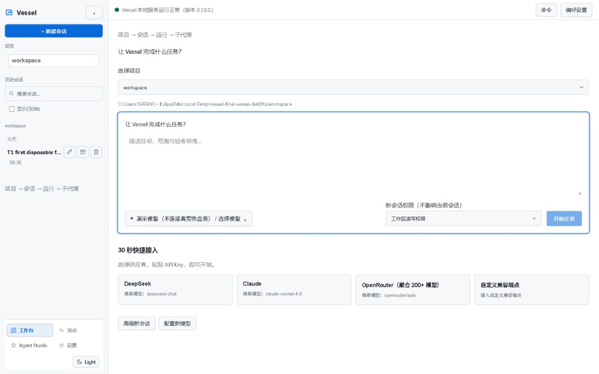
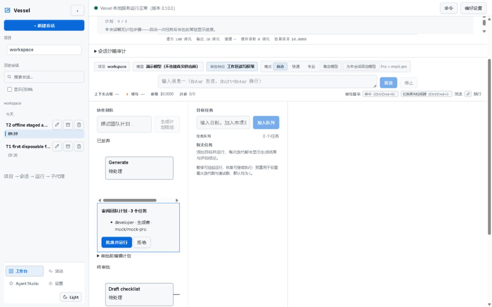
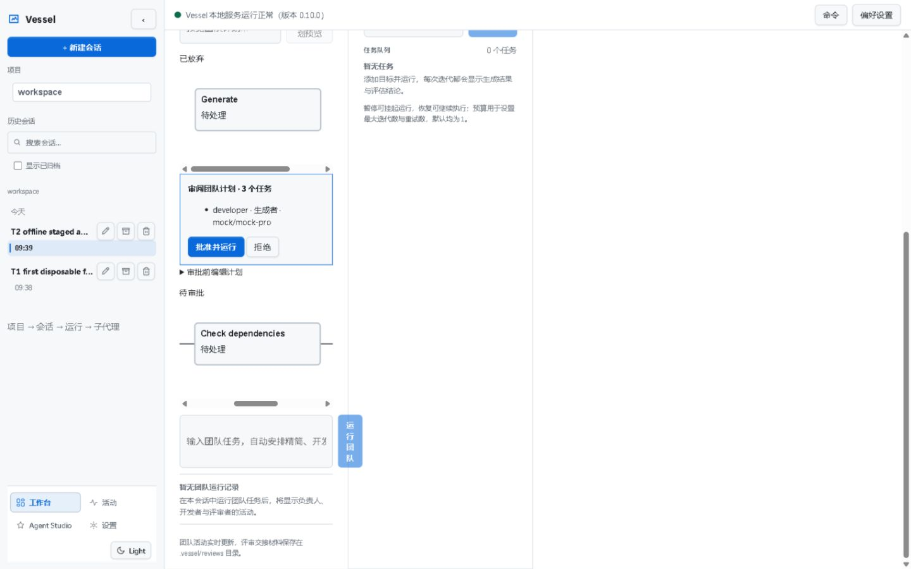
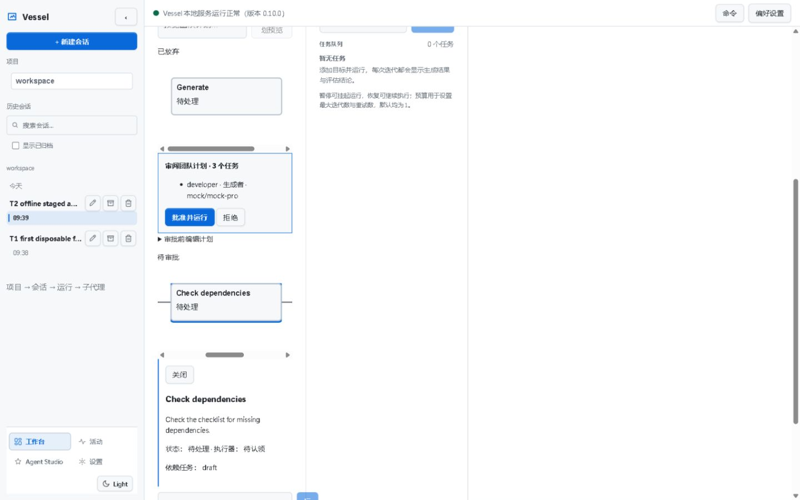
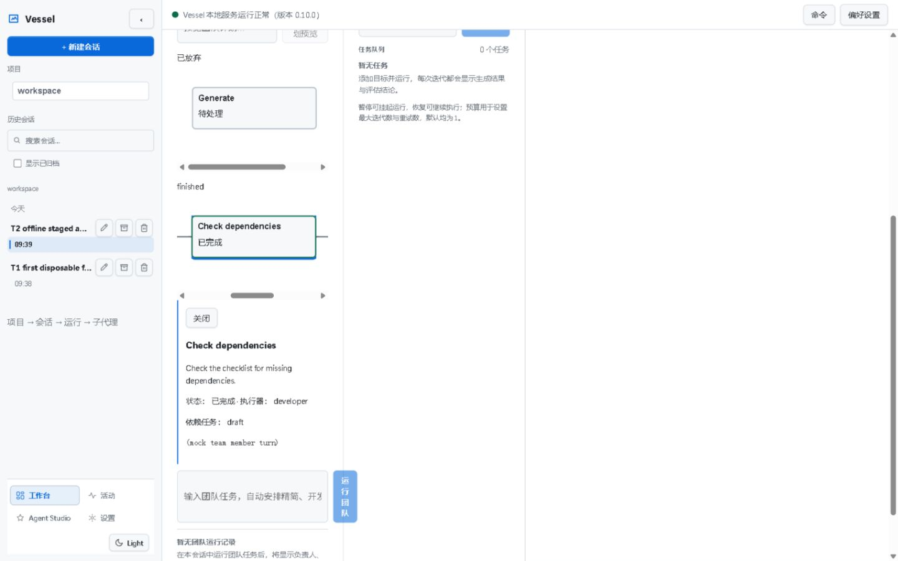

# Final sweep — 2026-10-28

This report completes the bounded T1–T5 attempt. It does **not** accept any whole card or replace the maintainer's visual sign-off.

| Item | Verdict | Observed result | Evidence |
|---|---|---|---|
| T1 — keyboard/focus | **不通过 / FAIL against the literal script** | Esc restored the same Delete trigger; all seven focus rectangles were visible; Console errors 0; the disposable session was deleted. Step 5 landed on **Confirm**, whereas the sweep says **Cancel**. The supplied step-5/6 expectations conflict. | `t1-keyboard.json`, `t1-1440x900.png` |
| T2 — staged banner | **通过 / PASS** | Developer roster, `mock / mock-pro` route, Approve & Run and Reject simultaneously visible. | `t2-staged-banner.png`, `t2-measurements.json` |
| T2 — canvas | **部分通过 / partial** | Real three-node DAG with two dependency paths. Pending and completed colours captured; running observed in the accessibility snapshot. A third captured colour and simultaneous full-DAG visibility remain **UNVERIFIED**. | `t2-canvas.png`, `t2-approved.png`, `t2-measurements.json` |
| T2 — node drawer | **部分通过 / partial** | Selected Check dependencies; dependency `draft`, executor `developer`, actual 23-character output visible. 300-character truncation and artifact links **UNVERIFIED**, because the built-in mock produced short text and no artifacts. | `t2-drawer.png`, `t2-drawer-completed.png` |
| T2 — approval | **通过 / PASS for offline mock execution** | UI Approve & Run → running → finished, 3/3 tasks completed; Console errors 0. | `t2-approved.png`, `t2-measurements.json` |
| T3 — references | **通过 / PASS as a reference update** | Card 179 points to T1/T2 and inherits their limitations. Historical full-gate counts remain attributed to the coordinator. | Card 179 appendix |
| T4 — tray/toast visibility | **无法验证 / UNVERIFIED** | Daemon start exit 0 in 1.878s; screenshot command rejected before capture. No icon, menu or toast observation. Stop exit 0; port released. | Exact rejection below; `cleanup.json` |
| T5 — sandbox contracts | **通过 / PASS** | Five requested commands exit 0: 5 files / 32 tests. | `t5-checks.json`; raw logs in TEMP |
| T5 — offline conformance | **通过 / PASS** | 25/25, 0 failed, 0 skipped, 0 errors, $0, **4.7380032s**; only Vessel adapter. | `t5-checks.json`; raw report in TEMP |

## Environment and dist freshness

- Initial working tree clean on `main`, HEAD `ba67265` (`docs(board): consolidate every remaining item into one Codex sweep sheet`), one documentation commit after the prompt's stated `50ce6f4`. No checkout or branch change.
- Single main chat; no subagents and no external Agent CLI. The sheet requested `gpt-6.1-sol` / `medium`, Fast off; no model-switching or CLI model probe was performed. Host-effective model/effort were not independently queried.
- Required `node node_modules/typescript/bin/tsc -b tsconfig.json`: exit 0.
- Required `npm run -w @vessel/web build`: exit 0; script is `vite build --emptyOutDir false`. No clean build.
- Fresh `apps/web/dist/index.html` mtime: **2026-10-28T16:37:03.078Z**, or **09:37:03 PDT**. Referenced JS: **assets/index-CXJPjUxG.js**.
- No full gate, geometry recheck, old viewport recapture, or dual-root full-test rerun. Supplied historical evidence is retained as historical attribution.
- Retained independent fixture: `C:\work\AppData\Local\Temp\vessel-final-sweep-1eKEKs\workspace`.
- Child-process HOME, USERPROFILE, APPDATA, LOCALAPPDATA, VESSEL_SESSION_ROOT, VESSEL_PROVIDER_ROOT, VESSEL_USAGE_ROOT, VESSEL_MCP_ROOT, VESSEL_SETTINGS_ROOT and VESSEL_DAEMON_ROOT each pointed beneath that TEMP root. `VESSEL_TRASH_TTL_DAYS=0`.
- Free port **5678** used for serve; **5700** checked free before the daemon attempt. Other existing listeners were not replaced.
- Visible IAB created successfully on the first attempt. Supported viewport override measured `innerWidth=1440`, `innerHeight=900`, DPR approximately 1.000000011; Chinese/light UI. No CDP screenshot, fake DOM, fake status, real browser zoom or IME probe.
- All six `tab.screenshot({fullPage:false})` outputs were actually JPEG (`ffd8ffe000104a46`). Pillow decoded them and saved PNG without resizing, cropping or compositing. Every delivered PNG has signature **89504e470d0a1a0a**, dimensions **1440×900**. Raw captures remain in TEMP. See `screenshot-formats.json`.

## T1 — exact sequence and actual focus

Two sessions were created through UI and each completed an offline mock turn. The target was the **second-created** disposable session, titled `T1 second disposable focus session`; newest-first ordering placed it above the first session. It was reached using 11 actual Tab presses from the composer. No click or programmatic focus was used in the seven-step sequence.

| Step | Key/action | Actual focused control | Rectangle x / y / w / h | Visible | Console errors |
|---|---|---|---|---|---|
| 1 | Tab to target Delete | Target Delete | 217.061 / 351.663 / 27.994 / 27.994 | yes | 0 |
| 2 | Enter | Cancel | 56.594 / 436.650 / 40.597 / 27.994 | yes | 0 |
| 3 | Esc | Same target Delete | 217.061 / 351.663 / 27.994 / 27.994 | yes | 0 |
| 4 | Enter | Cancel | 56.594 / 436.650 / 40.597 / 27.994 | yes | 0 |
| 5 | Shift+Tab | **Confirm** | 11.997 / 436.650 / 40.597 / 27.994 | yes | 0 |
| 6 | Enter | New-task textarea after deletion | 300.931 / 320.439 / 1098.226 / 150 | yes | 0 |
| 7 | Full viewport screenshot | Same textarea | 300.931 / 320.439 / 1098.226 / 150 | yes | 0 |

Every step's actual `document.activeElement.outerHTML.slice(0,120)`, rectangle and Console list are recorded in `t1-keyboard.json`. The second session disappeared, while `T1 first disposable focus session` remained. Deletion used the product's recoverable trash with automatic expiry disabled.

**Criterion conflict:** reopening confirmation focuses Cancel. Shift+Tab moves to Confirm; Enter then confirms deletion. The sweep says Shift+Tab should land on Cancel but then Enter should confirm deletion. These expectations cannot both describe the observed button actions. This report records FAIL for the literal step-5 criterion; it does not infer a new product defect or silently rewrite the script.



## T2 — live staged plan, canvas and approval

1. Created `T2 offline staged approval` through the UI, session `sess_1793205593871_4f45b186`.
2. Used actual **same-origin HTTP**, not direct state-file writes: `POST http://127.0.0.1:5678/api/sessions/sess_1793205593871_4f45b186/team-stages`, with `Origin: http://127.0.0.1:5678`, JSON task plus `mode: pro`; response **201**. The server used its built-in `mock` team provider. Terminal fetch supplied the same Origin header; this was not a browser DOM mutation.
3. The default plan had one node. The public `POST /api/team/stages/<id>/revise` endpoint, also with the same Origin, accepted a legitimate three-task pending dependency chain (**201**). The old stage became rejected; no status was fabricated. Full request/response bodies are preserved in `t2-measurements.json`.
4. Refreshed UI, reopened the session, and enabled Team through Preferences → Workspace view. Team was initially hidden. Inspector's task tree was inspected first; the staged DAG actually belongs to the Team module.
5. Captured the live banner: `developer`, generator, `mock / mock-pro`, Approve & Run and Reject. The routeSnapshot in the API matches the displayed route. Both buttons were visible at y=694.109, height=31.993.
6. Revised stage **stage_35944e95-2874-4538-af05-642d0a68d461**: `draft` → `check` → `final`; three nodes, two edges. Staged distribution `pending:3`. The rejected one-node preview is a separate historical plan in the same UI.
7. Clicked Check dependencies. Drawer displayed its real description and dependency `draft`. After approval, it displayed executor `developer`, completed status and `(mock team member turn)` (**23 characters**).
8. Clicked the UI's **Approve & Run**. The immediate live accessibility snapshot showed `draft:running`, `check:pending`, `final:pending`; the next screenshot showed completed. The final public GET returned stage `finished`, tasks `completed:3`, and artifacts `[]` for each. Console error list **[]**.

The canvas's 724px SVG is inside an approximately 242px horizontal viewport. Screenshots show actual nodes and connected line segments while horizontally scrolled; they do not show every node simultaneously. This is disclosed as a viewport limitation. It is not replaced with a reconstructed SVG image.

**UNVERIFIED:** a third distinct status colour in pixels; ready/running/failed colour screenshots; output truncation at 300 characters; artifact file links; all three nodes simultaneously visible. Running was observed as live accessibility state, but that observation does not certify its colour. The built-in offline provider produces short text, no files, and completes too quickly for the requested colour matrix in this attempt. No fabricated output, fake states, provider replacement or external multi-Agent run was used.










## T3 — historical references only

Card 179 now references the above T1/T2 results and inherits their limits. As requested by sweep T3, it repeats the coordinator attribution **334 files / 3,704 passed + 8 skipped; web 59 files / 528 passed**. The sweep preamble separately quotes an older 333 / 3,694 + 8 snapshot and latest 335 / 3,706 + 8 snapshot. These counts were not rerun or reconciled, and none is presented as a fresh measurement from this chat.

## T4 — bounded attempt

Isolated command `node apps/cli/dist/cli.js daemon start --port 5700 --json` exited **0**, elapsed **1.8776721s**, listeners **1**. The one prescribed PowerShell desktop capture was rejected before execution (exact text below). No desktop image exists, so tray icon, notification-area overflow, Open/Stop menu and native toast delivery are **UNVERIFIED**. No substitute mock or alternate desktop capture was used. The bounded attempt took under one minute, below the ten-minute cap.

`node apps/cli/dist/cli.js daemon stop --json` exited **0**; listeners **0**. The previously accepted detached-lifecycle result is not reclassified.

## T5 — targeted offline checks

| Command suffix after `node node_modules/vitest/vitest.mjs run` | Files | Tests passed | Vitest duration | Exit |
|---|---|---|---|---|
| `packages/tools/src/execution/sandbox/windowsRestricted.test.ts` | 1 | 14 | 1.31s | 0 |
| `packages/tools/src/execution/sandbox/platformSandbox.test.ts` | 1 | 9 | 1.05s | 0 |
| `packages/runtime/src/process/Process.sandbox.test.ts` | 1 | 4 | 266ms | 0 |
| `packages/application/src/nativeSandboxIntegration.test.ts` | 1 | 2 | 3.83s | 0 |
| `packages/tools/src/shell/shellTool.sandbox.test.ts` | 1 | 3 | 1.96s | 0 |

Offline conformance passed using:

```text
cmd.exe /d /c "npm run bench:conformance -- --out C:\work\AppData\Local\Temp\vessel-final-sweep-1eKEKs\conformance"
```

The output option keeps the runner's normally repository-bound report in TEMP. The first PowerShell invocation failed in npm flag forwarding before any scenario ran; one literal-argument retry passed. Actual output: **25 fixtures × 1 adapters (vessel) [offline]**, **25 run / 0 skipped / 0 error**, **25 passed, 0 failed, cost $0**. End-to-end command elapsed **4.7380032s**. No `--live`, external Agent CLI, quota probe, paid provider or network baseline was run.

Raw logs and conformance JSON/Markdown remain in the retained TEMP root; exact filenames and commands are in `t5-checks.json`.

**Boundary:** these results prove offline contracts remain green. They do **not** prove Windows ACL / Low Integrity enforcement on this host. Administrator provisioning, cross-boundary writes and revoke remain A2; macOS lifecycle remains A3.

## Cleanup and scope audit

- Serve PID **14236** was checked against the fixture command line and stopped. Ports **5678** and **5700**: **0 listeners**. Fixture Node processes: **0**. See `cleanup.json`.
- Team visibility preference restored to initially hidden; viewport override reset; test tab closed. No user-owned app or listener was stopped.
- TEMP fixture, raw captures, logs and reports retained. No agent-issued permanent deletion or cleanup command. Existing requested test/runner cleanup is not represented as a recycle-bin operation.
- A new untracked `Microsoft/Windows/PowerShell/ModuleAnalysisCache` (12,847 bytes, creation 16:46:17.989Z) appeared during the attempt. It was absent from the initial clean tree. Its exact repository path was validated and the generated `Microsoft` directory was **moved**, without deletion, into retained TEMP `generated-powershell-cache`. This transient out-of-allowlist cache write is disclosed; final scope checks do not erase that history.
- The first T3 append command let PowerShell interpret Markdown backticks as escape characters. Only this chat's new appendix was corrected; the original card's byte prefix was preserved. No historical card content was changed.
- No product source, tests, scripts, configuration, `.pdw/`, card status line, task index or old evidence was intentionally edited. No add/commit/push/branch, new card or memory update.
- Final tracked changes: appended text only in the six permitted cards. New repository files exist only in this evidence directory. Prefix hashes, file listing and final diff check are recorded in `scope-audit.json`.

Changed tracked paths:

```text
tasks/175-visual-team-dag-canvas-and-staged-approval.md
tasks/176-headless-daemon-and-tray-resilience.md
tasks/179-epic-universal-team-workspace-and-daemon-mesh.md
tasks/180-os-native-sandboxing-and-restricted-tokens.md
tasks/183-epic-hardened-runtime-and-cognitive-memory.md
tasks/277-ui-p2-fixes.md
```

## Failed or rejected operations — exact commands and outcomes

These were inspection/tooling failures, not repaired product defects. No unchanged failing operation was retried more than once. The desktop capture was attempted once and stopped on rejection.

1. Initial read-only path lookup contained two nonexistent CLI paths; `rg` emitted system error 2. The same tool batch's later successful read masked its process exit. No file was written:

```text
rg -n "VESSEL_.*ROOT|command\('serve|workspace|teamProviders|daemon start" apps/cli/src/commands/serve.ts apps/cli/src/commands/daemon.ts apps/local-server/src/server.ts
```

2. A PowerShell command combining free-port inspection and an inline regex read failed parsing before execution, exit 1: `Unexpected token ')' in expression or statement.` Original command:

```powershell
$taskPorts=Get-NetTCPConnection -State Listen -ErrorAction SilentlyContinue; $taskCandidates=@(5678)+(5700..5799); $taskPort=$taskCandidates | Where-Object { $_ -notin $taskPorts.LocalPort } | Select-Object -First 1; if (-not $taskPort) { throw 'No free fixture port' }; Write-Output "fixture_port=$taskPort"; rg -n "serve|--workspace|VESSEL_SESSION_ROOT|VESSEL_DAEMON_ROOT" apps/cli/src/cli.ts apps/cli/src/serve.ts apps/cli/src/daemon.ts packages/application/src; node -e "const fs=require('fs'),p='apps/web/dist/index.html';let s=fs.readFileSync(p,'utf8');console.log(JSON.stringify({mtime:fs.statSync(p).mtime.toISOString(),assets:s.match(/assets\/index-[^\" ]+\.js/g)}));"
```

3. Windows literal-path glob lookups emitted error 123 and nonexistent `modules.ts` emitted error 2. Subsequent direct reads located the Team module; no source modification:

```text
rg -n 'TeamDagCanvas|TeamStagedBanner|TeamStages|team-stages|Stage' apps/web/src/components/Inspector* apps/web/src/components/team apps/web/src/App.tsx
rg -n 'TeamModule|team.*enabled|team' apps/web/src/components/Workspace* apps/web/src/App.tsx apps/web/src/modules.ts
```

4. UI selector attempt failed once; the Preferences summary is exposed as a generic in the DOM representation. A fresh AX observation identified its existing button index, which was then clicked:

```javascript
await tab.playwright.getByRole('button',{name:'偏好设置',exact:true}).click();
```

```text
Error: Playwright selector deadline exceeded
waiting on click for selector internal:role=button[name="偏好设置"s]
Locator diagnostics: {"kind":"no_matches","action":"click","locator":"internal:role=button[name=\"偏好设置\"s]","matchCount":0,"matches":[],"visibleCount":0,"truncated":false}
```

5. First screenshot format-conversion command rejected before execution:

```powershell
Add-Type -AssemblyName System.Drawing; $taskRoot='C:\work\AppData\Local\Temp\vessel-final-sweep-1eKEKs'; $taskOut='E:\Code_file\Projects\Vessel_Harness\evidence\sessions\2026-10-28-final-sweep'; foreach($taskFile in [IO.Directory]::GetFiles($taskRoot,'*.raw')) { $taskBytes=[IO.File]::ReadAllBytes($taskFile); $taskMagic=[BitConverter]::ToString($taskBytes[0..7]); Write-Output ([IO.Path]::GetFileName($taskFile)+' magic='+$taskMagic); if ($taskBytes[0] -ne 255 -or $taskBytes[1] -ne 216) { throw 'Unexpected screenshot magic' }; $taskImage=[Drawing.Image]::FromFile($taskFile); try { $taskTarget=Join-Path $taskOut ([IO.Path]::GetFileNameWithoutExtension($taskFile)+'.png'); $taskImage.Save($taskTarget,[Drawing.Imaging.ImageFormat]::Png); Write-Output ([IO.Path]::GetFileName($taskTarget)+' '+$taskImage.Width+'x'+$taskImage.Height) } finally { $taskImage.Dispose() } }
```

The conversion itself subsequently succeeded using Pillow, without the rejected runtime type-loading mechanism.

6. T4's one prescribed desktop capture rejected before execution; no retry:

```powershell
Add-Type -AssemblyName System.Windows.Forms,System.Drawing
$b=[System.Windows.Forms.SystemInformation]::VirtualScreen
$bmp=New-Object System.Drawing.Bitmap $b.Width,$b.Height
$g=[System.Drawing.Graphics]::FromImage($bmp); $g.CopyFromScreen($b.Left,$b.Top,0,0,$bmp.Size)
$bmp.Save("$env:TEMP\vessel-tray-$(Get-Date -f HHmmss).png")
```

Both 5 and 6 returned this exact hook reason:

```text
Command blocked by PreToolUse hook: ⛔ HOOK 已拦截危险命令：运行时构造脚本块/类型（ScriptBlock::Create / Add-Type）无法静态验证，按 fail-closed 拒绝.
```

7. The same keyword scanner also rejected a documentation append whose string quoted the type-loader name. The append did not execute. The permitted card appendix was later written using the file-editing tool and a saved script:

```text
node -e "const fs=require('fs');fs.appendFileSync('tasks/176-headless-daemon-and-tray-resilience.md','\n\n## 2026-10-28 final sweep - T4 visibility only\n\nUNVERIFIED: isolated daemon start on free port 5700 exited 0 (1.878s; one listener). The single prescribed PowerShell desktop capture was rejected by the local PreToolUse safety hook because Add-Type cannot be statically verified. No desktop image was produced; tray icon, Open/Stop context menu and native toast visibility were not observed. Per the bounded stop rule, no alternative capture or retry was attempted. Daemon stop exited 0 and port 5700 listener count returned to 0. Existing detached-lifecycle acceptance is not changed. Full command/rejection and final cleanup: `evidence/sessions/2026-10-28-final-sweep/report.md` and `cleanup.json`.\n');"
```

Rejection reason identical to item 6. Recording the rejection as inert documentation did not execute the rejected capture operation.

8. One adapter inspection used a stale path, emitted error 2; corrected by file discovery to `contracts/vessel.ts`:

```text
rg -n 'mkdtemp|tmpdir|workspaceRoot|copy|rmSync|writeFile' benchmarks/runners/src/adapters/vessel.ts
```

9. First conformance invocation exited 1 in **0.3126682s**, before scenarios. Exact invocation:

```powershell
$taskRoot='C:\work\AppData\Local\Temp\vessel-final-sweep-1eKEKs'; $taskStart=[DateTime]::UtcNow; npm run bench:conformance -- --out (Join-Path $taskRoot 'conformance') *> (Join-Path $taskRoot 't5-conformance.log'); $taskCode=$LASTEXITCODE; Write-Output "conformance_exit=$taskCode elapsed_seconds=$(([DateTime]::UtcNow-$taskStart).TotalSeconds)"; exit $taskCode
```

```text
npm warn "C:\work\AppData\Local\Temp\vessel-final-sweep-1eKEKs\conformance" is being parsed as a normal command line argument.
npm error code EUNKNOWNCONFIG
npm error Unknown cli flag:
npm error   - --out
npm error Run `npm help config` for supported options.
```

The original npm failure also generated its normal diagnostic log in the user's existing npm cache, as its output states; subsequent npm cache output was redirected beneath TEMP. Raw failure log retained as `t5-conformance.log`. One `cmd.exe /d /c` literal-argument retry succeeded, as documented above.

## Maintainer-only boundaries — not attempted

| Appendix item | Current status |
|---|---|
| A1 — 150%/200% page zoom and native IME | Still maintainer-only; not attempted or replaced by DPR emulation. |
| A2 — Windows ACL / Low Integrity enforcement | Still requires administrator provisioning/write-denial/revoke; offline tests above do not satisfy it. |
| A3 — macOS escaped-process lifecycle | No macOS kernel on this Windows host; not attempted. |
| A4 — card 154 release-report refresh | Requires quota/network authorization; not attempted. |
| A5 — literal three-hour soak | Not run or reopened; supplied equivalent-pressure decision retained. |
| A6 — live cross-harness | Not authorized in this sweep; no external harness launch or adapter repair. |
| A7 — U1–U5 external matters | Unchanged; no support ticket, remote operation, identity/governance change or cleanup. |
| A8 — user visual sign-off | Still belongs to the maintainer; use the images above and the disclosed T1/T2 limits. |

Appendix B exclusions were not reopened. Existing backup directories, historical TEMP references, profileParity and combined-load test observations were left alone.

---

## Coordinator note (2026-10-28, appended after review)

T1's `verdict: FAIL` in `t1-keyboard.json` is **not a product failure**. The step list in the
instruction sheet contradicted itself: it asked for `Shift+Tab` to reach Cancel and then for
`Enter` to confirm the deletion. The observed behaviour — Cancel focused on open, `Shift+Tab`
moving to Confirm, `Enter` deleting — is the correct focus order.

Measured against the authoritative criteria in `tasks/277-ui-p2-fixes.md` (Browser recheck):
open shows Cancel focused, `Esc` returns to the **same** delete button (identical 217.06,351.66
rect, not the first one), Tab/Shift+Tab move without trapping, and every step recorded zero
console errors. T1 is therefore signed off for that subset; the sheet carries an after-the-fact
correction. The executor's decision to run the steps as written and to record the mismatch
instead of adjusting the criterion is the behaviour we want.

T2's three unverified items (three distinct status colours, 300-character truncation, artifact
links) are fixture limits, not defects: the offline mock emits a 23-character reply and creates no
files. Panorama clipping is recorded as an observation: the SVG is about 724px wide inside a 482px
column at 1440×900 and needs horizontal scrolling; that is existing layout, not this round's work.

T4 stays UNVERIFIED after a second attempt from the coordinator: `ffmpeg -f gdigrab` captured the
whole desktop without `Add-Type`, the visible notification area showed no Vessel icon, and the
overflow panel was not opened because that would move the maintainer's mouse.

T5 was re-run independently by the coordinator: five commands exit 0 with 14+9+4+2+3 = 32 passed,
and offline conformance 25 runs / 25 passed / 0 failed / $0.
