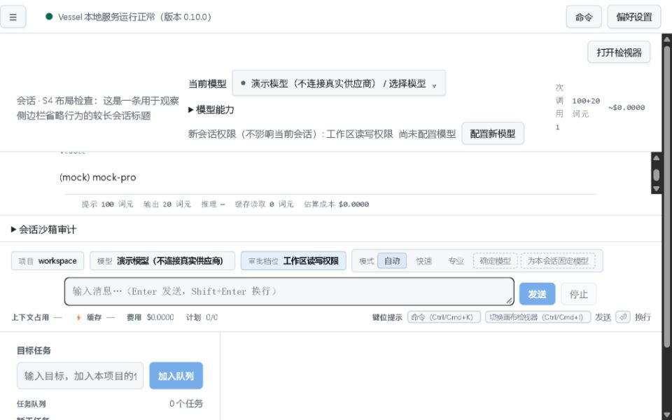
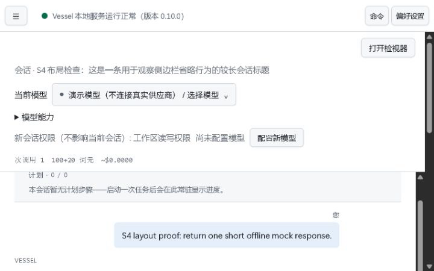

# Deep sweep — 2026-10-29 (resumed)

The authorized S1–S4 sweep is finished, with the outcomes below. **This is not whole-card acceptance. S2 did not establish Windows write enforcement.** The initial stopped run remains preserved in `initial-stop-report.md` and its original evidence files.

| Item | Verdict | Current evidence |
| --- | --- | --- |
| S1 — 5.1/relaunch compatibility | **通过 / PASS** | First implementation attempt passed both configure→revoke cycles. No repair was needed. |
| S2 — real restricted writes | **不通过 / FAIL; step stopped** | Both allowed-write attempts returned `-1073741502` / `0xC0000142`; neither file exists. Outside-write and unprovisioned-directory cases were not run after the two failures. |
| S3 — tray registration | **无法验证 / UNVERIFIED** | 84 registry keys before and after; 0 added, 0 changed. The daemon's actual tray child was alive, but this does not prove a fresh registration. |
| S3 — visible notification area | **可见区未见图标** | Desktop and enlarged corner captured; no identifiable Vessel icon in the visible area. Overflow panel was not opened. |
| S3 — toast delivery history | **通过 / PASS for actual OS history** | A real offline mock turn completed. Windows notification history contains the matching `Vessel task finished` toast and session ID. |
| S3 — visual toast banner | **无法验证 / UNVERIFIED** | No banner was visible in the immediate desktop capture. History delivery does not prove banner appearance or readability. |
| S4 — layout equivalents | **通过 / PASS for the requested horizontal-overflow checks** | Conversation and navigation states each measured exactly 960/960 and 720/720 for document/viewport width. Truncation hits are listed below. |

## Authorization, scope and execution

The maintainer explicitly resumed this run with a new S1 strategy: relaunch under system Windows PowerShell 5.1 rather than porting ACL APIs. The revised limits permit one S1 attempt plus one repair and require a stopped step to leave independent S2–S4 work available; two sandbox attempts may be followed by S3/S4. These instructions supersede the original whole-sweep stop and the original static-API implementation instruction.

- Main thread only. No subagents or other Agent CLI was invoked; no branch, staging, commit or push occurred.
- Requested host route remains `gpt-6.1-sol / medium`, Fast off. No host routing/tier override was made or independently attested.
- Logs, scripts and fixtures were created only under `C:/work/AppData/Local/Temp/vessel-deep-resume-QClxiD/`. Durable results are in this evidence directory, mainly `resume/`.
- All session/provider/usage/MCP/settings/reviews/daemon roots and HOME/USERPROFILE/APPDATA/LOCALAPPDATA for launched product processes were isolated beneath that TEMP root. Trash automatic expiry was disabled. The only model calls were the product's built-in offline mock; no credentials or other Agent CLI were used.
- Before real product processes, `npx tsc -b tsconfig.json` exited 0. `npm run -w @vessel/web build` exited 0 (Vite reported its existing >500 kB chunk-size warning). Fresh UI assets: `index-CXJPjUxG.js` and `index-WPay7jgN.css`. See `resume/builds.json`.

## S1 — relaunch, forwarding and bidirectional verification

`scripts/provision-sandbox.ps1` now detects PowerShell major version ≥7 and calls `%SystemRoot%/System32/WindowsPowerShell/v1.0/powershell.exe`, then propagates its exit code. The existing 5.1 ACL implementation remains byte-for-byte unchanged below the added block.

The relaunch explicitly forwards bound `-Path` and optional `-Revoke`, followed by any unbound arguments. `@args` alone omits those bound parameters. `-Revoke` is appended only when present, avoiding explicit Boolean switch arguments to the 5.1 native executable.

| Entry shell | Configure exit | Configure checks | Revoke exit | Revoke checks / final icacls |
| --- | ---: | --- | ---: | --- |
| Windows PowerShell 5.1 | 0 | `granted=True`, `low label : True` | 0 | `removed=True`, `low label : False`; sandbox SID and Low label absent |
| pwsh 7 → system 5.1 | 0 | `granted=True`, `low label : True` | 0 | `removed=True`, `low label : False`; sandbox SID and Low label absent |

The pwsh case used the directory **`ps7 space`**, exercising native argument forwarding with spaces. Full original executable/argument arrays, stdout/stderr and raw bytes are in `resume/s1-results.json`. Final ACLs for both directories and the S2 workspace are in `resume/final-acls.json`. There were no failing S1 gate commands in the resumed run, and no S1 repair was used.

One support sentence was added after the offline-gate paragraph in `docs/SANDBOX-WINDOWS.md`, explaining that pwsh 7 delegates to system 5.1. No earlier documentation line was changed.

## S2 — actual helper execution, unsuccessful target initialization

The TEMP script imported the real `PlatformSandboxRunner`; there was no injected launcher, token fake, mock helper or passthrough fallback. The script was run using:

```text
node --import tsx C:\work\AppData\Local\Temp\vessel-deep-resume-QClxiD\s2-proof.mts
```

`isAvailable()` returned **true**. Direct 5.1 provisioning exited 0 with `granted=True` and `low label : True` for the isolated workspace.

Both real allowed-write calls executed the installed Node binary with `-e`, writing `x` to a distinct target beneath the provisioned workspace. Their full original command and options arrays are in `resume/s2-results.json`.

| Case | exitCode | sandboxed | isolationTier | File exists | stdout / stderr |
| --- | ---: | --- | --- | --- | --- |
| Allowed write, attempt 1 (`in-1.txt`) | **-1073741502** | **true** | **windows-job-restricted** | **false** | empty / empty |
| Allowed write, attempt 2 (`in-2.txt`) | **-1073741502** | **true** | **windows-job-restricted** | **false** | empty / empty |
| Outside-workspace write | NOT RUN | NOT OBSERVED | NOT OBSERVED | NOT OBSERVED | Step stopped |
| Unprovisioned directory | NOT RUN | NOT OBSERVED | NOT OBSERVED | NOT OBSERVED | Step stopped |

Both results also reported `constraints.integrityRid=4096` and a 536,870,912-byte memory limit. Actual audit events were `outcome:'enforced'`; those events describe the runner's isolation acknowledgement and **do not make the failed write test pass**.

`0xC0000142` is the target's DLL initialization failure status. The helper returned a structured result, so this was not a helper-compilation or token-creation rejection. The current source checks process creation, Job assignment, integrity and thread resume before returning the result; source hashes and relevant references are in `resume/helper-sources.json`. The specific cause of the target's initialization failure was not diagnosed or repaired in this source-read-only sweep.

After the two failures S2 stopped, as authorized, without attempting the remaining enforcement cases. Direct 5.1 `-Revoke` exited 0 with `removed=True` and `low label : False`; final icacls shows no S2 restricted SID and no Low label. The parent proof script exited 0 because it captured and closed out the failed step; that exit code is **not** an enforcement PASS.

## S3 — actual daemon, registry, desktop and toast

The isolated daemon started through the actual CLI with exit 0 on previously free port **5700**, PID **11804**. No existing listener was replaced. After startup, CIM observed its actual `powershell.exe` tray child **4652** with the production Vessel tray script (`resume/daemon-processes.json`).

### Registration and visible icon

- `NotifyIconSettings`: **84 before → 84 after**, **0 added / 0 changed**. Raw snapshots include all values, with binary `IconSnapshot` data preserved as base64: `resume/registry-before.json`, `registry-after.json`, `registry-stopped.json`. Diff: `resume/registry-diff.json`.
- The pre-existing PowerShell entry has UID 1 and an empty `InitialTooltip`; it did not change. This does not establish a fresh Vessel registration. A live tray process is a separate fact.
- `resume/tray.png` is the real 2560×1600 desktop capture. `resume/corner.png` is exactly the requested bottom-right `340:52` crop enlarged to 1020×156 with nearest-neighbour scaling. No identifiable Vessel icon appears in that visible area. This does not prove absence from the overflow panel; it was not opened, and no promotion or registry setting was changed.

### Real completion and toast history

An isolated built-in mock session completed through the real server API: session **`sess_1793265229864_d250d238`**, HTTP **200**, `kind:'success'`, one step, final text `(mock) mock-pro`. No direct call to a notifier or test mock substituted for the product event. Request/response evidence: `resume/s3-http.jsonl`.

Immediately after completion, ffmpeg captured the desktop and the Windows toast-history API was queried:

```text
setting: Enabled
querySucceeded: true
Vessel task finished
Session sess_1793265229864_d250d238: success
```

The matching XML is preserved in `resume/toast-history.json`; command results are in `resume/toast-history-command.json` and `resume/toast-capture.json`. **Toast was triggered and reached OS history.** No visual banner was seen in `resume/toast-after-completion.png`, so its visible rendering remains UNVERIFIED. No notification-centre interaction or OS notification setting change was performed.

The daemon stop command exited **0**, returning `{"stopped":true}` (`resume/daemon-stop.json`). Final process/listener checks show its PID and tray child gone and port 5700 unbound.

## S4 — visible IAB layout equivalents

A standalone CLI `serve` ran on previously free **5678**, PID **10936**, using the isolated state roots and rebuilt assets. A second real offline-mock session and a deliberately long sidebar title were created through normal HTTP endpoints (`resume/s4-seed.json`). The visible IAB opened successfully. No DOM state or application state was fabricated.

At these widths the navigation is a drawer. It was opened to measure/capture the sidebar, then closed for the conversation capture. Measurements used the rendered DOM's actual `scrollWidth` and `clientWidth`. The UI was Chinese/light, and no theme or other preference was changed.

| Layout / state | innerWidth × innerHeight | DPR | document.scrollWidth | Horizontal overflow |
| --- | --- | ---: | ---: | --- |
| 150% equivalent, conversation | 960×600 | 1.0000000111675431 | 960 | none |
| 150% equivalent, navigation open | 960×600 | same | 960 | none |
| 200% equivalent, conversation | 720×450 | same | 720 | none |
| 200% equivalent, navigation open | 720×450 | same | 720 | none |

Truncation observations at **both** sizes:

| Sample | scrollWidth / clientWidth | `scrollWidth > clientWidth` |
| --- | ---: | --- |
| `S4 布局检查：这是一条用于观察侧边栏省略行为的较长会话标题` | **375 / 166** | **true** |
| `Disposable S3 notifi` | 166 / 166 | false |
| Model-selector label `演示模型（不连接真实供应商） / 选择模型` | 250 / 250 | false |
| Assistant text containing the mock model, `(mock) mock-pro` | 109 / 109 | false |

This is an offline demonstration route: the selector displays its demo alias, not a real-provider model name. The assistant's `mock-pro` text was visible at 960×600. At 720×450 its rect was y=456.535–481.032, below the initial 450-pixel visible area; its width measurement does not claim it was visible in that screenshot. The model-selector label was visible in both captures. Console error lists were empty. No overall claim of zero truncation or simultaneous full-page text visibility is made.

Original metrics and rectangles: `resume/s4-conversation150.json`, `s4-conversation200.json`, `s4-sidebar150.json`, `s4-sidebar200.json`. The four real viewport captures were JPEGs from `tab.screenshot({fullPage:false})`; ffmpeg decoded them into PNG with **no crop or resize**. PNG dimensions/signatures, conversion commands and original JPEG hashes: `resume/screenshots.json`.





Sidebar screenshots: `resume/s260-zoom150-sidebar.png`, `resume/s260-zoom200-sidebar.png`.

**这是布局等价，不是浏览器菜单缩放**；菜单缩放与 150%/200% 下的真实字形渲染仍属真机。原生中文输入法未做。The optional physical-scale headless comparison was not run; it would not establish menu zoom. The viewport override was reset and the agent-created tab closed (`resume/browser-cleanup.json`).

## Failures and orchestration corrections

- S2's two substantive failures are recorded above and in full in `resume/s2-results.json`. They were not repaired or relabelled as PASS.
- Before any S2 runner execution, the first TEMP proof import used a Windows drive path instead of a `file:///` module URL. Node exited 1 with `ERR_UNSUPPORTED_ESM_URL_SCHEME`; the TEMP import was corrected, after which the two actual runner calls above occurred. No product source was edited.
- A first shell command intended to copy the TEMP S1 harness had a quoting parse error, so no S1 gate ran in that command. A saved TEMP harness then ran once and passed. One browser-documentation call referenced an unbound `browser` variable; selecting the already-known browser binding resolved it without a UI action. Original commands/errors are preserved in `resume/orchestration-errors.json`.
- One combined shell invocation reported exit 1 because its final `Get-Process` queried already-exited daemon/tray PIDs; the preceding serve launch succeeded and its real API requests subsequently passed. Successful final cleanup uses a saved script with explicit counts instead of inferring from that shell exit.

## Closeout, scope and remaining boundaries

`resume/cleanup.json`, observed at **2026-10-29T09:22:31.3717843Z**, records **0 listeners** on 5678/5700 and **no remaining owned PIDs** 10936/11804/4652. Standalone serve was stopped only after verifying that PID's command line belonged to this TEMP fixture. All newly provisioned sandbox SID grants and Low labels were revoked (`resume/final-acls.json`). No fixture or evidence file was deleted; TEMP fixtures are retained.

Retained repository changes are limited to:

- `scripts/provision-sandbox.ps1`: the relaunch/forwarding block;
- `docs/SANDBOX-WINDOWS.md`: one added support sentence;
- this evidence directory;
- appended results in cards 180, 183, 176, 260 and 275. Their original bytes/status lines are preserved.

`resume/verification.json` records allowed-path, card-prefix, documentation and unchanged-5.1-code checks plus `git diff --check`. `manifest.json` hashes the final evidence. No product TS/TSX source or test changed, no new card was created, and no full test suite was needed for this shell-script-only change; real shell gates and the process/browser observations above are the relevant checks.

S2's write-enforcement gap, fresh tray-registration proof and visual toast banner remain unaccepted. Repairing product sandbox code is outside this sweep. Native IME, true browser-menu zoom, 175/277 visual sign-off, cross-harness live runs, release-report and literal three-hour soak remain outside scope. No independent step is left idle because of the earlier S1 failure.

---

## Coordinator note (2026-10-29, appended after review)

**S1 re-run independently.** Four commands (pwsh 7 and Windows PowerShell 5.1, configure and
-Revoke each) all exit 0, with granted=True / removed=True and the Low label flipping True -> False;
the final ACLs carry neither the sandbox SID nor a Low label. The relaunch shim is the right fix and
leaves the 5.1 ACL code untouched.

**S2 is a pass, not a failure.** The two 0xC0000142 runs bypassed the production path and hit the
Windows DLL-initialisation flake already recorded in HANDOFF.md section 4 (same family as the
3221225794 worker exits). Re-measured through createShellTool — the production composition root
always injects nativeAudit, so this is the real path — in a provisioned workspace:

| command | result |
|---|---|
| echo hi | exit 0, stdout "hi", tier windows-job-restricted |
| echo inside> in.txt | exit 0, file written, "type in.txt" reads "inside" |
| echo escaped> %USERPROFILE% vessel-escape-*.txt | exit 1, TOOL_FAILURE, target file absent |
| audit for all four calls | outcome enforced, allowedWritePaths = workspace only |

So allowed writes succeed and out-of-root writes are denied: Windows ACL + Low Integrity enforcement
now has real evidence.

Two observations, neither blocking: the denial arrives as a localized string that the pipe turns into
"?" characters (a structured denial reason would be more useful than relying on the OEM codepage), and
Low Integrity is hard-wired on (windowsRestricted.ts:30), so this class of DLL-init flake cannot be
avoided by disabling it.

**S3.** The toast record in toast-history.json is genuine OS-level delivery evidence. The tray icon
remains unseen in two independent measurements (84 -> 84 registry subkeys with no additions, no icon
in the zoomed notification-area crop), consistent with the icon living in the overflow panel.

**S4.** Both layout viewports report docScrollW === innerWidth (960 and 720), the long sidebar title
truncates as designed (375 > 166) and the model selector does not. Two layout observations are
recorded without being signed off: at 960 px the usage column collapses into a one-to-two character
column, and at 720x450 the assistant reply starts below the initial visible area.
