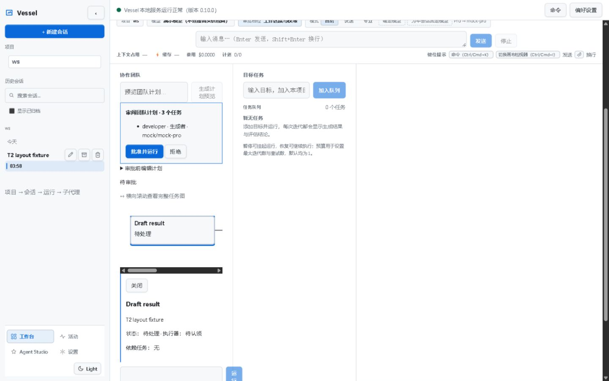

# Remaining work — 2026-10-29

This is evidence for cards 360 / 362 / 361 / 363, in that order. It does not sign off whole cards. Initial checkout: clean `main`, HEAD `0fb4f9b` (the handoff names the earlier `a974edd`). Requested route: gpt-6.1-sol / medium, Fast off; host-effective route was not independently queried. Main thread only. No Agent CLI, dependency installation, branch, staging, commit, push, live benchmark or full gate.

| Card / criterion | Verdict | Measured result | Evidence |
|---|---|---|---|
| 360 A1–A3: readable failed stderr, unchanged success | 通过 / PASS | Real native sandbox: `echo hi` → 0 / `hi`; workspace write → 0, `in.txt` exists; profile write → 1 / TOOL_FAILURE, readable ASCII hint, escaped file absent. Regression covers GBK bytes decoded as UTF-8 and literal question marks. | `t1-native.json`, `t1-checks.json` |
| 360 A4: targeted tools / build / test types | 通过 / PASS | 19 files, 169 passed + 3 skipped; both tsc commands exit 0. | `t1-checks.json`, `t1-types.json` |
| 362 A1: 960×600 / 720×450 meters | 通过 / PASS for measured fixture | Both themes: context width/scrollWidth 72/72px; cost 67/67px; one-line labels; no document horizontal overflow. Original character stacking did **not** reproduce before the change; CSS protects whole metric groups from shrinking. Supplied zoom150.png shows the task-start screen rather than the meters. | `t2-matrix.json`, `t2-comparison.html`, `t2-after-*-960.jpg`, `t2-after-*-720.jpg` |
| 362 A2: DAG at 1440 | 通过 / PASS for explicit-scroll alternative | 242px scroller / 724px SVG. Visible Chinese scroll hint; scroller keyboard-focusable. Every node title 180/180px and reachable via scrolling, without scaling down node text. | `t2-dag.json`, `t2-after-dag-*-1440.jpg` |
| 362 A3: 1440×900 / 1920 width | 通过 / PASS for scoped layout | Light/dark captures and measurements: no meter clipping or page overflow. Does not rerun or certify the historical 80-cell matrix. | `t2-matrix.json`, wide screenshots |
| 362 A4: component checks | 通过 / PASS | Final web suite: 60 files / 530 passed; web typecheck and production build to TEMP exit 0. | `t2-web-final.json`, `t2-types.json` |
| 361: 300-character truncation | Bound 通过 / PASS; indicator 不通过 / FAIL | Actual assistant message 570 characters → stage API 301 characters with final ellipsis → drawer exactly 300, stripping that ellipsis. No expand/ellipsis control. No product edit for T3. | `t3-proof.json`, `t3-drawer.json`, `t3-summary-300.jpg` |
| 361: actual artifact control | 通过 / PASS for clickable download | One real Write; artifact.txt 72 bytes. HTTP content 200, identical workspace/download bytes. UI control is a download button, not an anchor. | `t3-artifact-proof.json`, `t3-proof.json`, `t3-artifact.jpg` |
| 361: at least three node colors + failure | 通过 / PASS | Pending rgb(72,79,88); running rgb(121,184,255), team-pulse; completed rgb(74,222,148); failed rgb(255,124,114). Controlled HTTP 500 exhausted six attempts and produced a real failed node. | `t3-colors.json`, `t3-pending.jpg`, `t3-running.jpg`, `t3-completed.jpg`, `t3-failed.jpg` |
| 361 A3: once-only / widget duplication | Write 通过 / PASS; nonempty-widget dedup 无法验证 / UNVERIFIED | Repeat approval 409; one Write tool/result, one artifact. Zero widget records or rendered widgets: no duplication observed, but this cannot prove deduplication for a populated widget stream. | `t3-repeat-approval.json`, `t3-proof.json`, `t3-drawer.json` |
| 363 A2: product identity guard | 通过 / PASS for directly reproduced defect | Distinct NTFS identities `9288674232026648` and `9288674232026649` round to the same Number. Old product probe returned the fixture's private text in 10/10 swaps; bigint repair rejected 10/10. New regression covers this precision collision. | `t4-inode-probe.json`, `t4-product-before-repeat.json`, `t4-product-after-repeat.json` |
| 363 A1: original combined-run attribution | 部分通过 / partial | Direct old-product reproduction 10/10; two frozen combined runs 0/2 failures. Historical single flake attribution remains inferential; no claim of N≥10 combined runs. | `t4-preserved-before-repeat.json`, combined check JSONs |
| 363 A3: final integration | 通过 / PASS | local-server 319; CLI 783; two combined runs 1102 each, all exit 0. Build and both type checks exit 0; T4 approximately 13.5 minutes, within cap. | `t4-server.json`, `t4-cli.json`, `t4-combined-02.json`, `t4-combined-03.json`, `final-*.json` |

## Implementation choices and limits

- **360:** an ASCII hint avoids guessing the system code page after the native launcher has already lost characters. It appears only for nonzero native results with replacement characters or repeated question marks in stderr. It preserves the raw text, exit code, audit schema and failure classification; it suggests checking write roots without asserting the cause.
- **362:** only component layout/style/test files changed. DAG overflow remains intentional, now discoverable. [Before/after comparison](t2-comparison.html). Console errors: `t2-console.json`.
- **361:** normal UI saved a keyless local provider at `http://127.0.0.1:5693/v1`. The fixture uses supported `createVesselServer` options `teamProviders` and `tierBindings` to bind that HTTP provider to real TeamRuntime; normal serve's team provider defaults to mock and the UI provider store alone does not replace it. Stage creation and approval used public same-origin APIs/UI. No task states, output, file records or DOM were fabricated. Script path/hash, stage IDs, session evidence and full responses are in `t3-proof.json`; raw fixture/session/request files remain in TEMP. Console errors: `t3-console.json`.
- The fixture workspace has no Git HEAD. Its diff control correctly reports `Git comparison unavailable for this workspace.` The content/download comparison is independent of Git.
- Browser download used its default Downloads directory once. Matching bytes were verified, then the owned file was moved into TEMP. The original download path is absent; no download remains outside TEMP. This unexpected transient write is recorded explicitly.
- **363:** the first combined run overlapped source edits and failed the newly added regression (1101 passed, 1 failed). It is a mixed-revision run and is excluded from acceptance. Subsequent integration runs use frozen source. Attribution of the historical single flake to the measured collision is an inference; the product precision defect itself is directly reproduced.

## Exact rejected / failed operations

```text
echo x> %USERPROFILE%\vessel-remaining-escape.txt
=> exit 1; TOOL_FAILURE; stderr ????????
[hint] Command failed; stderr may use a non-UTF-8 code page. If writing files, check that the target is inside the sandbox allowed write roots.

POST /api/team/stages/stage_16183211-ea4b-4fc0-ac8d-221d022440c4/approve (repeat)
=> 409 {"error":"stage_conflict","message":"stage is not awaiting approval"}

Controlled failure node:
Model call failed after 6 attempt(s): OpenAI-compatible 500 Internal Server Error: {"error":{"message":"CONTROLLED_FAILURE: fixture HTTP 500"}}

node node_modules/vitest/vitest.mjs run apps/local-server apps/cli
First, mixed-revision run: 1 failed | 1101 passed; new collision regression:
AssertionError: expected [Function] to throw an error
```

Raw command logs stay in TEMP, located by the check JSON files. Early setup quoting/search/selector errors did not change product behavior; asynchronous failed-node selection succeeded once the final state arrived.

## Cleanup and scope

`cleanup.json` records zero listeners on owned ports 5691/5692/5693, stopped server PIDs 11488/26500, no sandbox SID grant or Low label, browser closed and viewport reset. The pre-existing port-5678 server was left running. TEMP evidence is retained for reproduction; no bulk cleanup or permanent deletion was performed.

All requested targeted check commands have passed on final source. The full gate remains reserved for the coordinator. `scope-audit.json` contains the changed-file list, append-only card checks and source SHA-256 hashes. No repository changes outside the allowed paths.

Reproduce the precision defect against the preserved pre-fix source (fixture and colliding NTFS pair retained in TEMP):

```powershell
node --import tsx "C:\work\AppData\Local\Temp\vessel-remaining-nfItcn\t4-product-probe.mjs" t4-repro.json before
# Current built implementation, same descriptor swap:
node "C:\work\AppData\Local\Temp\vessel-remaining-nfItcn\t4-product-probe.mjs" t4-fixed-repro.json
```

Expected: preserved version returns fixture text `private`; fixed version reports `artifact changed during open`. Repeat counts: 10/10 leakage before, 10/10 rejection after. The old source snapshot only rewrites its package import to the current local dist. This is a diagnostic fixture, not a model call.

Changed source/tests (10 files):

- packages/tools/src/shell/shellTool.ts
- packages/tools/src/shell/shellTool.sandbox.test.ts
- apps/web/src/components/ComposerMeters.tsx
- apps/web/src/components/ComposerMeters.test.tsx
- apps/web/src/components/composerMeters.css
- apps/web/src/components/team/TeamDagCanvas.tsx
- apps/web/src/components/team/TeamDagCanvas.test.tsx
- apps/web/src/components/team/TeamDagCanvas.overflow.test.tsx
- apps/local-server/src/teamRoutes.ts
- apps/local-server/src/teamStageApi.test.ts

Only appendices were added to cards 360/362/361/363 and the card-175 evidence pointer. Other new files are final report/screenshot/JSON evidence in this directory.


