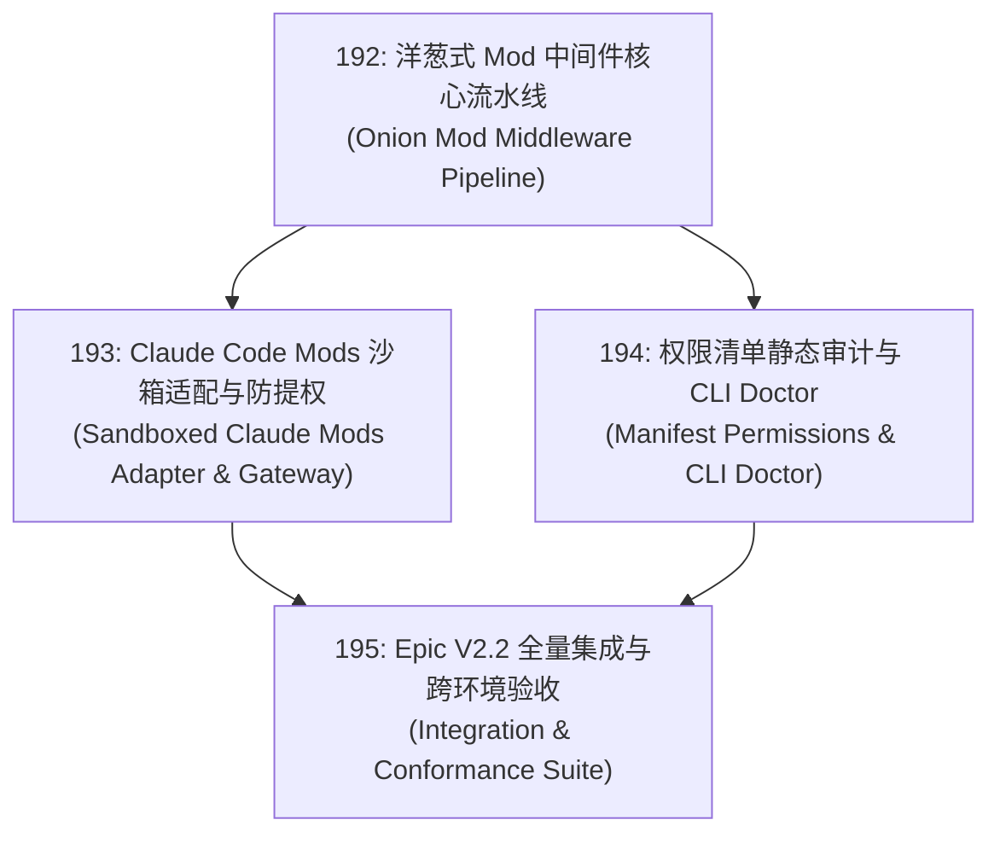

# 195 — Epic V2.2: 沙箱化 Mod 中间件网络与插件生态兼容 (Sandboxed Mods & Middleware Mesh)

- 编号：195
- 类型：Epic
- 优先级：P1
- 关联模块：`packages/policy`, `packages/runtime`, `packages/tools`, `packages/shared`, `apps/cli`
- 推荐执行配置：Codex (GPT-6.1 Sol · `reasoning.effort: medium`)
- 状态：已完成本地机械验收（2026-10-08；未提交，独立安全评审受阻）
- 创建日期：2026-10-08

---

## 1. 架构目标与背景

在主流 Agent 框架（Claude Code Mods、DeepSeek Harness 插件层）相继推出“拦截式中间件/Mod”功能后，生态扩展已从单纯的“为模型提供外部 Tool”进化为“深度介入 Agent 运行时生命周期的中间件网格”。

然而，当前业界生态存在两个致命风险：
1. **执行裸奔与越权风险**：第三方 Mod 直接在主进程内执行，能够任意访问进程内存、篡改沙箱级别、窃取存储在内存中的 API Key（正如 DSH CVE-2026-82533 所示，插件可通过覆盖原型链将 `danger-full-access` 注入不可信环境）；
2. **上下文污染与缓存破坏**：第三方 Mod 无节制向模型注入提示词碎片，动态乱序拼接导致 KV Cache 命中率雪崩。

本 Epic 确立 **Vessel V2.2 核心目标**：构建**安全受控、洋葱分层、隔离沙箱化**的 Mod 中间件网络，并在保持薄核与绝对安全的前提下无缝兼容 Claude Code Mods 生态。

---

## 2. 包含子任务清单与依赖拓扑

| 任务编号 | 任务标题 | 核心职责 | 预估影响模块 | 状态 |
| :--- | :--- | :--- | :--- | :--- |
| **192** | 洋葱式 Mod 中间件核心流水线 | 定义 `observe`/`rewrite`/`intercept` 三态洋葱契约与确定性管道，Fail-Closed 错误隔离 | `policy`, `runtime`, `shared` | 已验证（本地） |
| **193** | Claude Code Mods 沙箱适配与防提权 | Worker 隔离沙箱运行时、RPC 代理、拦截 CVE-2026-82533 提权与凭据访问 | `runtime`, `tools`, `policy` | 已验证（本地） |
| **194** | 权限清单静态审计与 CLI Doctor | `vessel.mod.json` 静态权限声明、CLI 命令（list/inspect/verify/audit/doctor）与动态告警 | `apps/cli`, `policy` | 已验证（本地） |
| **195** | Epic V2.2 全量集成与机械验收 | 跨 Harness 兼容性验证、KV Cache 稳定性回归、双 Root 测试全绿通过 | 全仓集成 | 已验证（本地） |

---

## 3. 架构红线与设计约束 (Iron Rules)

1. **薄核（Thin Core）零侵入**：`packages/core` 代码行变动为 0。所有中间件与生命周期挂载通过 `packages/policy` 的 Interceptor 与 `packages/runtime` 的 Hook 机制驱动。
2. **零信任 Worker 隔离**：第三方未签名 Mod 严禁在主进程运行，必须运行于 `worker_threads` 或受控沙箱容器内，通过受限 RPC 与主进程通信。
3. **凭据物理不可达**：Mod 上下文中不包含任何 `ApiKey`、`CredentialStore` 实例或真实环境变量指针；所有需要网络调用的外部请求由主进程 Policy Engine 统一审核代发。
4. **防提权不可篡改**：运行态 Policy Engine 实例对 Mod 冻结（`Object.freeze`），严禁任何 Mod 修改自身的权限范围（针对 CVE-2026-82533 彻底闭环）。
5. **KV Cache 保护**：Mod 贡献的额外提示词段必须放入三段式前缀的 `scopedPrefix` 尾部，打上明确的 `[Mod: <name>]` 标签，严禁随机插队破坏静态前缀。

---

## 4. 机械验收标准 (DoD)

- [x] **子任务闭环**：192、193、194 三张子卡全部通过自身用例并完成交付证明；
- [x] **测试覆盖与门禁**：
  - 新增 Mod 专属单元与集成测试文件（不少于 12 个测试文件，覆盖隔离、拦截、审计、提权攻防）；
  - 全量测试 `npm run test:all`（根 vitest + web vitest）全部通过，既有 2811 用例无回归；
  - `npx tsc -b tsconfig.json` 与 `npm run typecheck:tests` exit 0；
  - `npm run -w @vessel/web build` 正常通过；
- [x] **CLI 冒烟验证**：
  - `npx tsx apps/cli/src/cli.ts mod list` 正常展示静态发现、启用状态与沙箱要求；
  - `npx tsx apps/cli/src/cli.ts doctor --mods` 能够成功检出未授权危险 Mod 并输出红色警告；
- [x] **安全基准核验**：
  - 构造模拟提权 Mod（尝试读取 API Key 或提升文件写入权限），确认系统均以 exit code 1 或 Policy Denied 阻断，记录在 `evidence/` 审计报告中。

## 5. 集成执行器工作证明（2026-10-08）

- 显式接线 `ComposeOptions.mods` 与 CLI `run --mod <directory>`；发现清单不自动运行。
- Runtime 执行顺序为原输入 Policy → observe → rewrite → 重验 Policy → intercept/工具 → 主进程审计 → 逆序 observe；任一 Mod 异常或非法结果 DENIED 并熔断。
- Worker RPC 独立走只含 Read/Write/Edit 的工作区受限工具集及普通 Executor，无 Mod 递归；源目录位于工作区外也不扩张 RPC 可读写范围。
- Mod 提示词只在启动时处理自身贡献，带标签冻结进 scopedPrefix 尾部；真实消息、易变尾部与压缩恢复路径均覆盖。
- 最后一次源代码修改后：定向 **14 文件 / 100 测试**通过；`tsc -b`、`typecheck:tests` 均 exit 0。四个新增集成相关测试文件覆盖 17 用例。
- 完整证据与兼容边界：`evidence/sessions/2026-10-08-v2.2/card195-integration-proof.md`；日志 `card195-focused-tests.log`、`card195-tsc-build.log`、`card195-test-types.log`。
- 独立安全评审未完成；确定性攻防与行为测试为本执行器证据，不宣称独立安全审计通过。全仓最终门禁与交接状态由主控制器整合。

## 6. 最终控制器验收

- 双 Root：根 250 文件 / 2734 passed / 6 skipped；Web 20 文件 / 177 passed，共 2911 passed。构建、测试类型与 Web 构建全部 exit 0。
- CLI 实际冒烟通过，恶意 mock 清单的 audit 与 doctor 均按预期 exit 1；core 0 改动，依赖与锁文件不变。
- 总证据：`evidence/sessions/2026-10-08-v2.2/PROOF.md`。独立安全评审被内容过滤阻断，不宣称独立审计 PASS。兼容范围为无依赖预编译 JS 子集。
- 本轮未提交、未推送、未发布；方向 C 不自动续跑。
