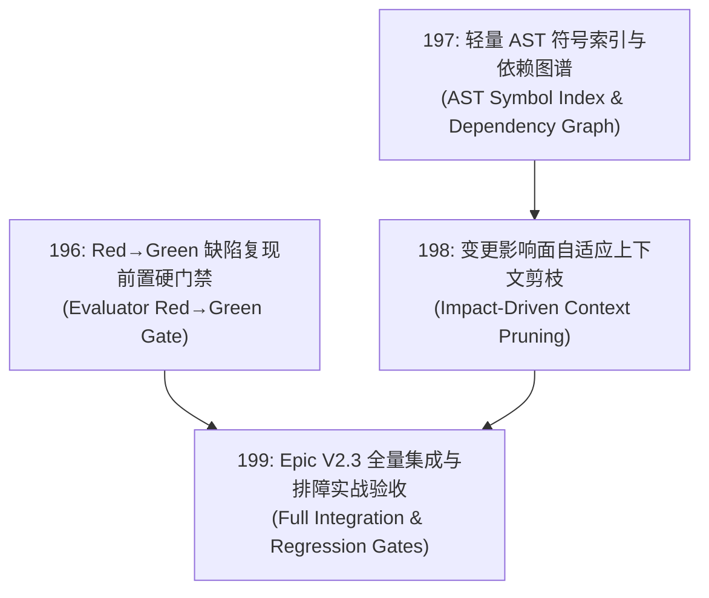

# 199 — Epic V2.3: 结构化代码感知与 Red→Green 复现前置硬门禁 (AST Code Awareness & Red→Green Gates)

- 编号：199
- 类型：Epic
- 优先级：P1
- 关联模块：`packages/policy`, `packages/context`, `packages/tools`, `packages/runtime`, `packages/shared`
- 推荐执行配置：Codex (GPT-6.1 Sol · `reasoning.effort: medium`)
- 状态：completed（用户批准197完整语义性能指标15/25；最终双Root2957passed/6skipped及全部类型/Web门禁exit0）
- 创建日期：2026-10-08

---

## 1. 架构目标与背景

随着 Vessel 的执行循环迈入高阶自主编码，传统的粗粒度文本检索与单向 Generator 自我宣布完成暴露出严重局限：
1. **代码理解精度不足**：纯靠 `grep` 无法捕捉复杂 Monorepo 下跨包符号的拓扑关系，重构极易导致依赖断裂；
2. **长任务注意力塌陷与 Cache 振荡**：多轮会话产生海量探索噪音，缺乏基于影响半径的语义修剪；
3. **修复闭环缺乏真凭实据**：在修 Bug 场景下，往往由于缺少“修改前先证明测试失败（Red）”的机械门禁，导致模型输出大量看似通过实则失效的伪修复代码。

本 Epic 确立 **Vessel V2.3 核心目标**：构建**结构化 AST 代码感知体系**与**严格的 Red→Green 缺陷复现硬门禁**，使 Vessel 具备专业工业级工程排障与精确重构能力。

---

## 2. 包含子任务清单与依赖拓扑

| 任务编号 | 任务标题 | 核心职责 | 预估影响模块 | 状态 |
| :--- | :--- | :--- | :--- | :--- |
| **196** | 评估器 Red→Green 缺陷复现硬门禁 | 两阶段闭环校验（先失败 Red 后成功 Green）、防伪凭据防造假 | `policy`, `runtime`, `shared` | completed |
| **197** | 轻量 AST 符号索引与依赖图谱 | TypeScript 符号解析、反向依赖拓扑分析、`code_symbol_graph` 只读工具 | `context`, `tools`, `shared` | completed（mean15/peak25） |
| **198** | 变更影响面自适应上下文剪枝 | 结合 Git Diff 与符号图计算爆炸半径，分层修剪长上下文，KV Cache 零破坏 | `context`, `behavior`, `runtime` | completed |
| **199** | Epic V2.3 全量集成与实战验收 | 端到端复杂 Bug 修复实战验证、符号索引性能回归、全仓本地门禁 | 全仓集成 | completed |

---

## 3. 架构红线与设计约束 (Iron Rules)

1. **薄核（Thin Core）零侵入**：`packages/core` 行变更保持 0。门禁逻辑通过 Policy Engine 挂载，符号图与剪枝器作为 Context Provider 与 Tool 插件注入。
2. **轻量与跨平台确定性**：严禁引入全量重量级 LSP 或对外部二进制语言服务的依赖；AST 解析基于成熟轻量的 TypeScript AST / 纯 JS 库，解析速度快且环境零依赖。
3. **KV Cache 强保障**：任何自适应剪枝只允许修剪上下文交互动态尾部，三段式前缀的静态与任务区绝对不可动。
4. **Generator/Evaluator 绝对隔离**：Red→Green 状态评定必须由独立门禁执行，测试执行退出码与断言错误必须由系统捕获，严禁 Generator 自行篡改评定凭据。

---

## 4. 机械验收标准 (DoD)

- [x] **子任务闭环**：196、197、198 全部交付并通过独立测试；
- [x] **全量回归通过**：
  - `npm run test:all`（根目录 Vitest + apps/web Vitest）全部通过；
  - `npm run typecheck:tests` 与 `npx tsc -b tsconfig.json` exit 0；
  - `npm run -w @vessel/web build -- --emptyOutDir false` exit 0；
- [x] **端到端实战检验**：
  - 构造一个经典的真实代码缺陷 Szenario，在有 Red→Green 门禁保护下，验证只有在提供真实 Red 证明并成功转 Green 时任务才允许完成。

## 5. 最终交证（2026-10-08，PASS）

最终 `npm run test:all` exit0：root258文件/2780passed+6skipped，Web20文件/177passed；构建、测试类型、独立Web测试和带emptyOutDir=false的生产构建均exit0。197scoped16/16及12次真实修改mean10.767/peak21.405通过批准的15/25指标。196真实Red1→Green0/Regression0和198的82.56%剪枝、前缀/任务保护在组合端到端用例验证。core0、基线文件缺失0；纯本地未提交/推送。证据 `evidence/sessions/2026-10-08-v2.3/PROOF.md`、completion-audit.json及accepted15-*.log。Epic blocked解除，已completed。

### 历史阻断检查点（保留）

`evidence/sessions/2026-10-08-v2.3/PROOF-before15.md` 记录原始双 Root 命令 root2777passed/6skipped/2failed及当时的blocked状态。所有原始失败与修复证据保留；最终验收由本节新交证替代。
