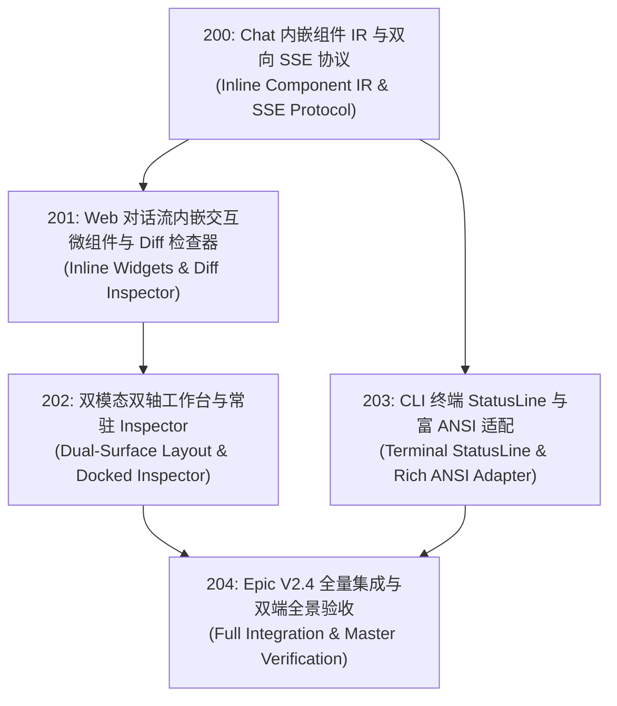

# 204 — Epic V2.4: 混合 Chat-Canvas 交互工作台与双端视觉中枢 (Hybrid Chat-Canvas & Interactive Workbench)

- 编号：204
- 类型：Epic
- 优先级：P1
- 关联模块：`apps/web`, `apps/local-server`, `apps/cli`, `packages/shared`
- 推荐执行配置：Codex (GPT-6.1 Sol · `reasoning.effort: medium`)
- 状态：已完成（2026-10-10，本地验收）
- 创建日期：2026-10-09

---

## 1. 架构目标与背景

随着主流 Agent 工具（OpenCode 2.0、Claude Code 2.1）将“富 UI 组件直接融入对话时间线”并结合全屏 TUI 与常驻画布，Agent 已经从粗糙的字符流终端进化为高信噪比的协同工作台。

Vessel 已经具备了业内领先的底层硬核体系（洋葱 Mod 沙箱、AST 依赖图、自适应 82% 剪枝、Red→Green 硬门禁、三段式前缀与原生沙箱），但此前这些能力主要体现在后台日志中，缺乏直观、高效的视觉交互呈现。

本 Epic 确立 **Vessel V2.4 核心目标**：构建**混合 Chat-Canvas 交互工作台（Hybrid Chat-Canvas Workbench）**：
1. **Chat 流融入就地富交互组件**：将 Diff、Red→Green 门禁验真、AST 影响面雷达与权限审批化为时间线上的微型应用卡片；
2. **双模态双轴工作台布局**：主轴对话流 + 副轴全景全能 Docked Inspector 画布（Swarm 拓扑、反思经验规则、KV Cache 波形、AST 符号拓扑一体化）；
3. **终端与 Web 双端对等体验**：Web 渲染高保真卡片，终端 TUI 渲染平滑 StatusLine 与折叠 ANSI 徽章；
4. **薄核（Thin Core）零侵入**：所有表现层协议与 UI 组件位于 `apps/` 与 `packages/shared`，`packages/core` 保持绝对 0 修改。

---

## 2. 包含子任务清单与依赖拓扑

| 任务编号 | 任务标题 | 核心职责 | 预估影响模块 | 状态 |
| :--- | :--- | :--- | :--- | :--- |
| **200** | Chat 内嵌组件 IR 与双向 SSE 协议 | 定义 WidgetBlock 契约、双向响应端点与流式通道扩展 | `shared`, `local-server`, `runtime` | 已完成（本地验证） |
| **201** | Web 对话流内嵌微组件与 Diff 检查器 | React 19 组件：DiffInspector、RedGreenBadge、ImpactRadar、PermissionAction | `apps/web`, `application` | 已完成（本地验证） |
| **202** | 双模态双轴工作台与常驻 Inspector | 主轴对话流 + 副轴全景全能 Inspector 画布（四大 Tab 集成），响应式布局 | `apps/web` | 已完成（本地验证） |
| **203** | CLI 终端 StatusLine 与富 ANSI 适配 | 动态底部单行状态栏（模型/沙箱/缓存）、彩色 Diff 摘要与终端审批 | `apps/cli` | 已完成（本地验证） |
| **204** | Epic V2.4 全量集成与双端验收 | 端到端全景冒烟演练、全仓回归门禁测试与交付闭环 | 全仓集成 | 已完成（本地验证） |

---

## 3. 架构红线与设计约束 (Iron Rules)

1. **薄核（Thin Core）零侵入**：`packages/core` 代码行变动严格为 0；
2. **纯本地开发**：遵循 2026-10-06 规约，绝对不执行 `git push`，不发布 npm 包；
3. **依赖锁定**：包管理器严格锁定 npm，严禁引入 pnpm/bun/yarn 锁文件；
4. **安全与删除纪律**：全仓删除进回收站（测试自建且位于 `os.tmpdir()` 内的临时目录除外）；
5. **无多余常驻守护占用**：UI 属于轻量接入层，避免引入沉重的外部后台二进制。

---

## 4. 机械验收标准 (DoD)

- [x] **子任务闭环**：200、201、202、203 四张子卡全部通过自身单元与集成测试；
- [x] **全量回归通过**：
  - `npm run test:all`（根目录 Vitest + apps/web Vitest 双 Root）全部通过；
  - `npx tsc -b tsconfig.json` 与 `npm run typecheck:tests` exit 0；
  - `npm run -w @vessel/web build -- --emptyOutDir false` 生产构建 exit 0；
- [x] **双端冒烟实战**：
  - Web 端打开 Session 页面，成功呈现双轴布局，就地触发一个 Diff 变更卡片，折叠与语法高亮正常；
  - CLI 终端启动交互，底部 StatusLine 正常显示当前模型与沙箱安全状态，无乱码闪烁；
- [x] **工作证明落盘**：
  - 产出交付证明至 `evidence/sessions/2026-10-09-v2.4/PROOF.md`，更新 `HANDOFF.md` 与状态机。

## 5. 最终交证

2026-10-10：双Root root263文件/2808passed+6skipped，Web22文件/201passed，合计3009passed。tsc、测试类型、Web类型、安全Web构建、help全部exit0，均在最后源码/测试编辑后运行。Web桌面/800px与离线TTY冒烟通过；独立复核PASS。core0、33保护哈希不变、依赖锁不变。未提交/推送/发布，无外部Agent。完整证据：evidence/sessions/2026-10-09-v2.4/PROOF.md。

