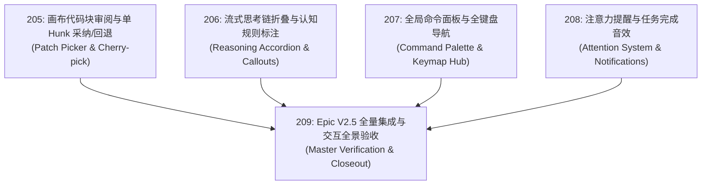

# 209 — Epic V2.5: 画布级交互协同、思考流折叠与极客工作台 (Interactive Collaboration & Canvas Workbench)

- 编号：209
- 类型：Epic
- 优先级：P1
- 关联模块：`apps/web`, `apps/local-server`, `packages/shared`, `packages/application`
- 推荐执行配置：Codex (GPT-6.1 Sol · `reasoning.effort: medium`)
- 状态：已验证（2026-10-10 本地完成，未提交）
- 创建日期：2026-10-10

---

## 1. 架构目标与背景

在 V2.4 成功落地双模态双轴工作台与内嵌组件后，Vessel 的交互层已经具备了工业级骨架。参考 OpenCode 2.0 的极客键盘流、Claude Code 的思考折叠透明度以及 Codex 的 Canvas 协同编辑，Vessel 需要进一步深化人机协同的细腻体验。

本 Epic 确立 **Vessel V2.5 核心目标**：构建**画布级交互协同、思考流折叠与极客工作台（Interactive Collaboration & Canvas Workbench）**：
1. **画布级局部 Cherry-pick（任务 205）**：告别全盘接受/拒绝，用户可在右侧画布对单改动块（Hunk）独立执行采纳、丢弃与回退；
2. **深度思考流透明化与经验标注（任务 206）**：带动态计时器的流式思考折叠卡片，并自动标注命中的 Vessel 认知反思规则；
3. **全局命令面板与全键盘导航（任务 207）**：`Ctrl+K` 极速指令搜索，`J/K/Space` 沉浸式全键盘消息交互；
4. **多端注意力提醒体系（任务 208）**：离焦桌面系统通知、纯 Web Audio 无资源合成完成音效，长任务无感挂起与及时唤回；
5. **薄核（Thin Core）零侵入**：`packages/core` 保持绝对 0 修改，全量门禁与 Web 构建通过。

---

## 2. 包含子任务清单与依赖拓扑

| 任务编号 | 任务标题 | 核心职责 | 预估影响模块 | 状态 |
| :--- | :--- | :--- | :--- | :--- |
| **205** | 画布代码块审阅与单 Hunk 采纳/回退 | 拆解 Unified Diff 为独立 Hunk，画布端就地采纳/回退 | `web`, `shared`, `application` | 已验证 |
| **206** | 流式思考链折叠与认知规则标注 | 思考耗时动态计时、折叠呼吸卡片、反思规则标签 | `web`, `shared` | 已验证 |
| **207** | 全局命令面板与全键盘导航 | `Ctrl+K` 快速指令面板，`J/K/Space` 键盘消息焦点控制 | `web` | 已验证 |
| **208** | 注意力提醒与任务完成音效 | 页面后台系统通知、原生 Web Audio 合成音效、标题徽章 | `web`, `shared` | 已验证 |
| **209** | Epic V2.5 全量集成与交互全景验收 | 交互全流程回归、双 Root 门禁通过、交付证明落盘 | 全仓集成 | 已验证 |

---

## 3. 架构红线与设计约束 (Iron Rules)

1. **薄核（Thin Core）零侵入**：`packages/core` 行修改必须为 0；
2. **纯本地开发**：遵循 2026-10-06 规约，不执行 `git push`，不发布 npm 包；
3. **依赖锁定**：严禁引入 pnpm/bun/yarn 锁文件，保持唯一 `package-lock.json`；
4. **安全与删除纪律**：全仓删除进回收站（测试自建且位于 `os.tmpdir()` 内的临时目录除外）；
5. **构建纪律**：Web 构建命令必须保留 `-- --emptyOutDir false`。

---

## 4. 机械验收标准 (DoD)

- [x] **子任务闭环**：205、206、207、208 全部通过定向测试；
- [x] **全量回归通过**：
  - `npm run test:all`（根目录 Vitest + apps/web Vitest 双 Root）全部通过；
  - `npx tsc -b tsconfig.json` 与 `npm run typecheck:tests` exit 0；
  - `npm run -w @vessel/web build -- --emptyOutDir false` 生产构建 exit 0；
- [x] **交互与用户体验全景核验**：
  - 启动服务在浏览器验证：`Ctrl+K` 面板正常弹出，思考流折叠动画丝滑，画布区可对单 Hunk 触发丢弃，静音开关生效；
- [x] **交付工作证明落盘**：
  - 输出交付证明至 `evidence/sessions/2026-10-10-v2.5/PROOF.md`，更新 `HANDOFF.md` 与状态机。

最终结果：Root 2832 passed + 6 skipped，Web 251 passed，合计 3083 passed；七项最终门禁 exit 0，独立评审与桌面/800px 浏览器通过。证明：`evidence/sessions/2026-10-10-v2.5/PROOF.md`。

